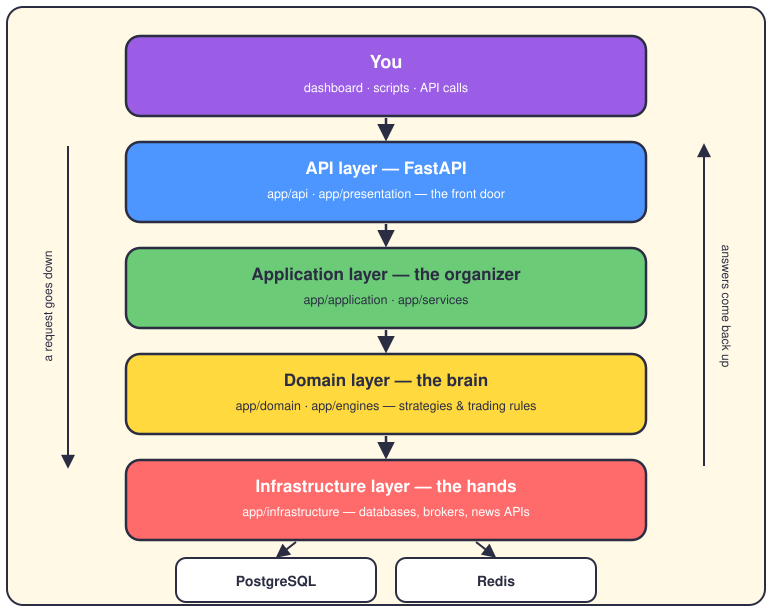

# How the system works

## The short version

AlgoTrading is a Python service that watches the market and decides whether a trade is worth taking. If it is, the system checks that the risk is okay and places the order. No human has to press a button. You can watch everything it does through a dashboard or by calling the API.

It's a big codebase, but the idea behind it is simple. Keep that in mind when the folder names get long.

## The layer cake



The code sits in layers. A request travels from the top to the bottom, and the answer travels back up. Each layer has one job and mostly ignores the others.

**API layer — the front door.** FastAPI lives here (`app/api`, `app/presentation`). It receives your requests, checks that you're allowed to make them, and passes them along. It doesn't think about trading at all.

**Application layer — the organizer.** `app/application` and `app/services` decide the order of the steps: get the data, run the strategy, save the result, send an alert. Like a good project manager, it doesn't do the specialist work itself.

**Domain layer — the brain.** `app/domain` and `app/engines` hold the actual trading knowledge: strategies, portfolio math, risk rules. On purpose, this layer knows nothing about databases or brokers. It just thinks.

**Infrastructure layer — the hands.** `app/infrastructure` does all the talking: PostgreSQL, Redis, brokers, external news APIs. If the outside world is involved, the code lives here.

## Why bother with layers?

Because the brain becomes easy to test. Since the domain layer doesn't know about databases, you can test a strategy with fake data in milliseconds, with zero setup. And if you ever switch brokers or databases, the brain doesn't change at all.

## Where the code starts

When the service boots, it runs `app/main.py`, which sets up FastAPI. During development you start it with uvicorn. For paper trading (real prices, fake money), the repo has two small scripts:

```bash
./start_paper_trading.sh   # start
./stop_paper_trading.sh    # stop
```

## Want to go deeper?

- `docs/architecture.md` — the classic architecture overview, more detail.
- `docs/developer/SYSTEM_OVERVIEW.md` — the developer's version.
- [The life of a trade](02-life-of-a-trade.md) — the next page in this series.
