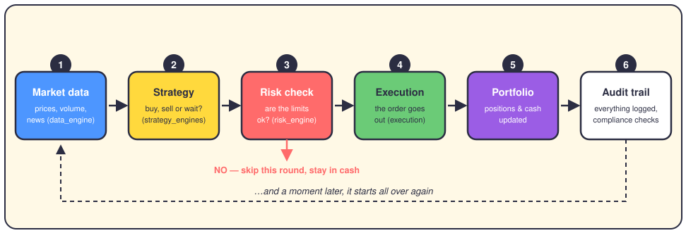

# The life of a trade

Imagine the service is awake and running. Over and over, quietly, it runs the same loop. Here is one full turn of that loop:

## The six steps, with a bit more detail

**1. Market data arrives.** The `data_engine` collects prices, trading volume and sometimes news. This is the raw material. Without fresh data, nothing else happens.

**2. A strategy has an opinion.** The strategy engines look at the data and produce a *signal*: buy, sell, or do nothing. A momentum strategy, for example, asks one simple question — "has this price been going up?" — and answers it with math.

**3. The risk engine votes.** Before any money moves, the `risk_engine` checks the limits: position size, how much we could lose, how exposed the portfolio already is. It can say no. When it says no, nothing happens that round — and that's not a failure, that's the design working.

**4. The order goes out.** The execution engine sends the approved order. In paper mode it goes to the simulator; in live mode it goes to a real broker. Same code path, different destination.

**5. The portfolio updates.** The `portfolio_engine` records the new position, the cash spent or received, and the running profit and loss. Now the system's memory matches reality.

**6. Everything is written down.** The trade lands in the audit trail, and compliance checks run after the fact. If anyone ever asks "why did the robot buy that?", the answer is sitting in the logs.

Then the loop starts again, a few seconds later, forever (or until you run `./stop_paper_trading.sh`).

One detail worth noticing: no signal can skip step 3. Not even a strategy that has been winning for six months gets a free pass past the risk engine.
