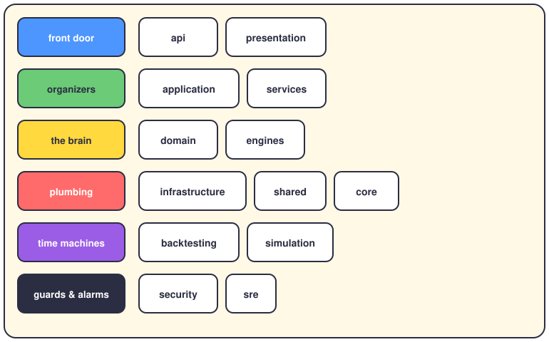

# The folder map

Open `app/` and you'll find seventeen folders. That's a lot, but they group into six simple ideas:

## The same map, in words

| Folder | In one line |
|---|---|
| `app/api` | HTTP endpoints — where requests come in |
| `app/presentation` | what the user sees: dashboards, formatting |
| `app/application` | use cases — the order of the steps |
| `app/services` | supporting services around the use cases |
| `app/domain` | strategies, portfolio math, trading rules |
| `app/engines` | data, strategy, risk, execution, portfolio and event engines |
| `app/infrastructure` | databases, brokers, external APIs |
| `app/shared` | small utilities many layers use |
| `app/core` | configuration and the basics |
| `app/backtesting` | run strategies on the past to see how they'd have done |
| `app/simulation` | pretend money, real prices |
| `app/security` | authentication and protection |
| `app/sre` | monitoring, alerts, keeping the thing alive |

## Two honest footnotes

This map is simplified on purpose. Some folders sit between colors — `engines`, for example, could argue it belongs to the domain *or* to the application layer. Don't worry about winning that argument. If you remember "front door, organizers, brain, plumbing, time machines, guards", you already know 90% of it.

And `tests/` isn't in the picture because it doesn't live inside `app/` — but it watches over everything. When you change the brain, the tests are what tell you if it still thinks straight.
