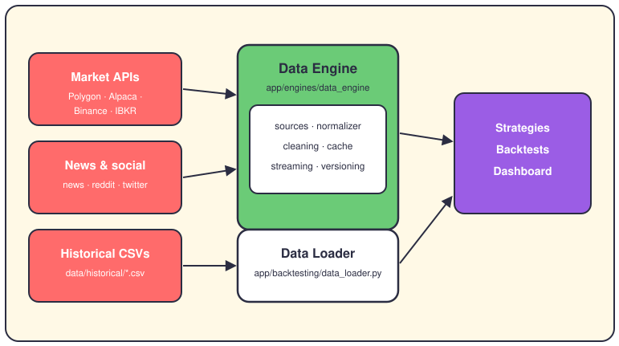
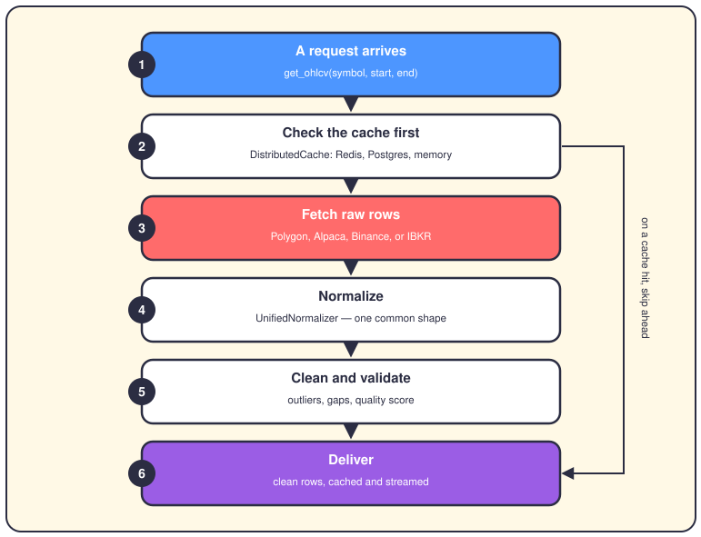

# The market data pipeline

## The short version

Nothing in this system can think until it has prices. Old prices arrive as CSV files on disk; fresh ones arrive from live market APIs. Both roads end in clean, tidy rows that strategies, backtests and the dashboard can trust.

## Where the data comes from

The coral boxes are the outside world. `data/historical/` holds one CSV per symbol with daily OHLCV rows — open, high, low, close and volume. Those files came from Stooq, a free price-history site. The other boxes are live feeds: Polygon, Alpaca, Binance and IBKR for prices, plus news, Reddit and Twitter for mood.

The mint box is the `DataEngine` class, the front door for live data. Call `get_ohlcv()` and it picks a source, normalizes, cleans and caches. Its settings come from `config/market/data_engine.yaml`, and it can also serve fundamentals, sentiment and option chains. The white box is the `DataLoader` class. Backtests use it: it reads a CSV if the file exists, or falls back to Yahoo Finance. Either way you get `Quote` objects — the standard price snapshot defined in `app/domain/models/market_data.py`. The grape box lists the buyers: strategies, backtests and the dashboard.

## The journey of one request

Step one is your call: one symbol, one date range. Step two asks the cache first — `DistributedCache` tries Redis, then PostgreSQL, then plain memory. A cache hit jumps straight to step six. Step three fetches raw rows from the first source that's configured and connected.

Step four normalizes: `UnifiedNormalizer` gives every source the same columns, timestamps and symbols. Step five cleans: odd outlier prices get dropped, missing days get filled in, and the batch gets a quality score. Step six delivers the rows, saves them to the cache, and can stream them over WebSockets to live listeners.

## Where it lives in the code

- `app/engines/data_engine/data_engine.py` — the `DataEngine` class: one API for prices, fundamentals, sentiment and options.
- `app/engines/data_engine/sources/` — one module per family: OHLCV feeds, fundamentals, sentiment, options.
- `app/engines/data_engine/normalizers/unified_normalizer.py` — reshapes every source into one common format.
- `app/engines/data_engine/validators/data_cleaning_pipeline.py` — outlier removal, gap filling, quality scoring.
- `app/engines/data_engine/cache/distributed_cache.py` — the `DistributedCache`: Redis, PostgreSQL, memory fallback.
- `app/engines/data_engine/versioning/` — data lineage and schema versions, so you know where rows came from.
- `app/backtesting/data_loader.py` — the `DataLoader`: CSV or Yahoo Finance in, `Quote` objects out.
- `data/historical/` — one CSV per symbol; daily OHLCV rows, some going back to 1984.
- `app/domain/market_analysis/` — microstructure analysis (order flow, liquidity, price discovery) that runs on the data.

## Want to go deeper?

- [Strategies](05-strategies.md) — the code that eats this data.
- [Backtesting](09-backtesting.md) — how old rows replay the past.
- [The folder map](03-folder-map.md) — a guided tour of `app/`.
