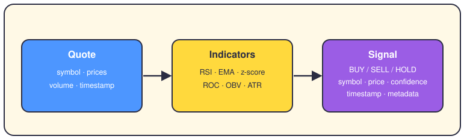
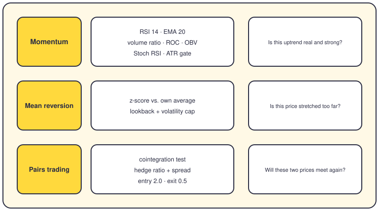
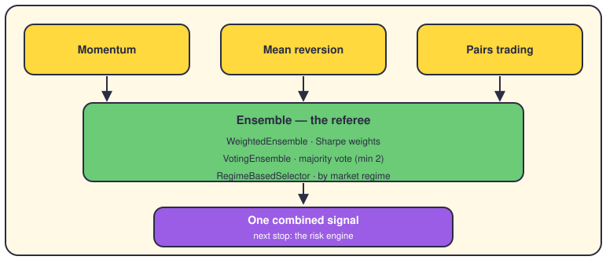

# Trading strategies

## The short version

A strategy is the part of the brain that turns prices into opinions. It reads fresh market data, boils it down to a few numbers, and answers with a signal: buy, sell, or hold. Here are the three core strategies, plus the referee that can team them up.

## From quote to signal

Every strategy follows the same pipeline, whatever its style. A quote (a snapshot of one symbol's prices and volume) goes in. The strategy turns price history into indicators, small numbers that describe the trend or the stretch. Then it wraps its verdict in a `Signal`, a data class from `app/domain/models/signal.py`. Its type is BUY, SELL or HOLD, and its confidence is a 0-100 score. Under 60, the signal isn't actionable, so downstream code ignores it. All strategies extend `BaseStrategy` from `app/domain/strategies/base.py`, so they share two methods: `generate_signals()` and `risk_check()`.

## The three strategies

**Momentum** buys strength, and `momentum.py` runs it. Its RSI (a 0-100 score of how fast price moved lately, period 14) must sit between 40 and 60. Price must hold above its EMA 20, a trend line that follows recent prices. Volume and ROC (rate of change) must confirm, and OBV (a running volume total) must not fall. Two guards watch the door: no BUY when RSI hits 70, no SELL at 30. A scoring engine then re-checks each signal before it leaves.

**Mean reversion** bets that stretched prices snap back, and `mean_reversion.py` runs it. It computes a z-score, which counts how far price sits from its own average, in normal steps. A very negative z-score means cheap: buy. Very positive means expensive: sell. A lookback window sets how much history counts, and a volatility cap blocks assets that swing too wildly.

**Pairs trading** works on two symbols at once, in `pairs_trading.py`. It first tests them for cointegration, a statistical bond where two prices wander but keep meeting again. The hedge ratio says how many units of one asset balance the other, and their difference is the spread. When the spread's z-score passes 2.0, the pair enters; near 0.5, it exits.

## When strategies team up

An ensemble is a team of strategies with a referee, and it lives with the engines, not in the strategies folder. `WeightedEnsemble` gives each member a weight based on its Sharpe ratio (profit divided by risk). `VotingEnsemble` waits for agreement: at least two strategies must point the same way. `RegimeBasedSelector` reads the market's mood (trending, wild, or calm) and picks the strategy that fits. When members disagree, the config picks the referee's rule: weighted, majority, or strongest.

## Where it lives in the code

- `app/domain/strategies/momentum.py` — `MomentumStrategy`: RSI, EMA, volume ratio, ROC, OBV.
- `app/domain/strategies/mean_reversion.py` — `MeanReversionStrategy`: z-score with a lookback window.
- `app/domain/strategies/pairs_trading.py` — `PairsTrading`: cointegration, hedge ratio, spread z-score.
- `app/domain/models/signal.py` — the `Signal` model: type, confidence, strength, metadata.
- `app/engines/strategy_engines/ensemble.py` — `WeightedEnsemble`, `VotingEnsemble`, `RegimeBasedSelector`.
- `app/shared/config/params/trading_thresholds.py` — the default numbers, like RSI 70/30 and the 40-60 zone.

## Want to go deeper?

- [The risk engine](06-risk-engine.md) — what can veto a signal before real money moves.
- [The life of a trade](02-life-of-a-trade.md) — follow one signal to a filled order.
- [Backtesting](09-backtesting.md) — how strategies prove themselves on old data.
