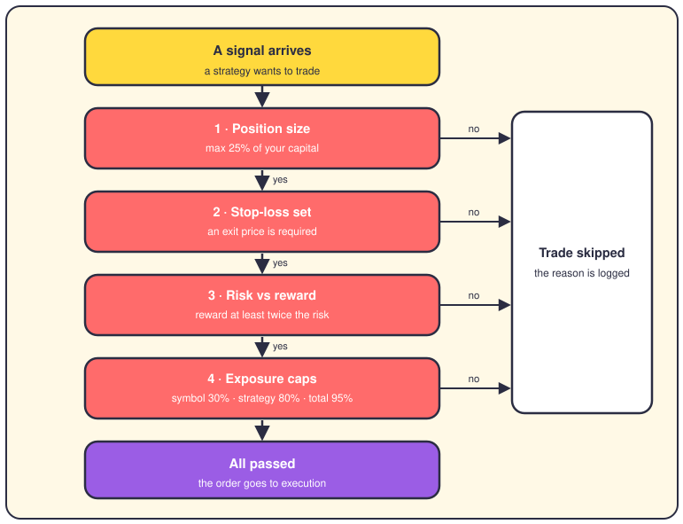
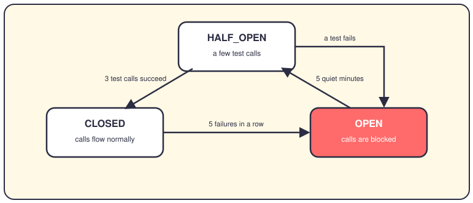

# The risk engine and circuit breakers

## The short version

Every trade must pass a set of risk checks before it's allowed to leave the system. If a check says no, the trade is skipped — no arguments. Circuit breakers are the louder cousin: they can pause all trading when the code or the market turns dangerous.

## The gates before every trade

Four gates stand between a signal and an order. A signal is a strategy saying "I want to buy this". Gate one caps position size, the money one trade may use, at 25% of your capital. Gate two demands a stop-loss, an exit price that cuts your loss if the trade goes bad. Gate three wants a possible reward at least twice the possible risk.

Gate four checks exposure, meaning how much of your money is already committed: 30% per symbol, 80% per strategy, 95% overall. A fifth check keeps trading inside regular market hours, 9am to 4pm. When any gate says no, the trade is skipped and the reason lands in the log. The next signal starts fresh.

## The breaker that guards the code

This breaker protects the machine, not the money. Every outside call — market data, orders, the broker — can fail, and the breaker counts those failures. The names come straight from the code: `CircuitState.CLOSED`, `OPEN` and `HALF_OPEN`. Five failures in a row open the circuit, so one broken service can't drag the rest down. After five quiet minutes it goes half-open and lets three test calls through.

If those test calls succeed, the circuit closes again. If one fails, it opens right back up. There are four of these breakers, one each for API errors, the data service, order execution and the broker connection.

## The breaker that guards the market

This one watches the market itself, using SPY as a proxy, a stand-in for the whole market. A 7% drop triggers `LEVEL_1` and trading pauses for 15 minutes. A 13% drop is `LEVEL_2`, same pause. A 20% drop is `LEVEL_3`, and trading stops for the rest of the day. It also reads the VIX, an index of expected market fear: 25 means warning, 35 means pause everything.

When it fires, all trading pauses and every pending order is cancelled. A loop then asks every 60 seconds whether the halt is still in place. The moment it lifts, trading resumes on its own — no human needed. That's the design: a failed gate costs you one trade, a tripped breaker costs you only time.

## Where it lives in the code

- `app/domain/services/trading_validators.py` — `TradingValidator`, the gates for position size, stop-loss, risk vs reward and trading hours.
- `app/services/compliance/compliance_engine.py` — `ComplianceEngine.validate_risk_envelope()`, the exposure caps per symbol, strategy and portfolio.
- `app/engines/risk_engine/__init__.py` — `RiskEngine`, which bundles the risk parts and keeps a history of every assessment.
- `app/engines/risk_engine/risk_limits_enforcer.py` — `RiskLimitsEnforcer.check_var_limits()`, which turns VaR into actions. VaR, or value at risk, estimates your worst likely loss.
- `app/services/api_circuit_breaker.py` — `CircuitState` and the API `CircuitBreakerManager`, the CLOSED / OPEN / HALF_OPEN machine.
- `app/services/circuit_breaker_manager.py` — the market breaker: `CircuitBreakerLevel`, `TradingStatus`, pause and resume.
- `app/shared/protocols/i_pre_trade_validator.py` — the `IPreTradeValidator` contract that pre-trade checks follow.

## Want to go deeper?

- [The life of a trade](02-life-of-a-trade.md) — see where these gates sit in a trade's journey.
- [Strategies](05-strategies.md) — meet the code that creates the signals being checked.
- [Execution](07-execution.md) — what happens once every check says yes.
