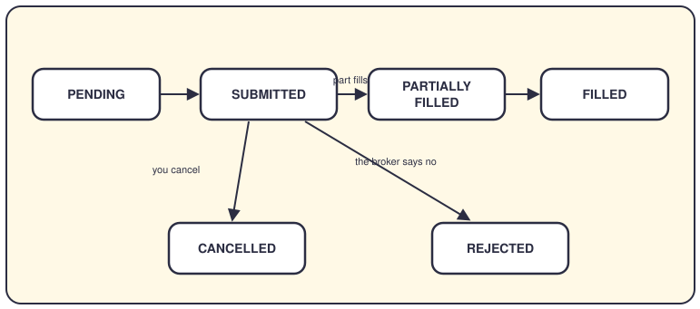
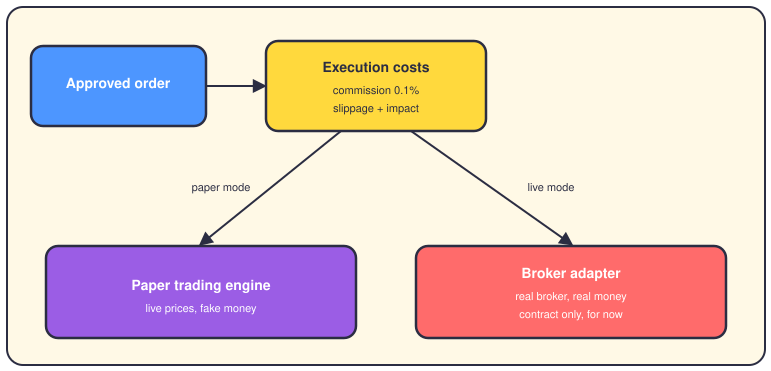
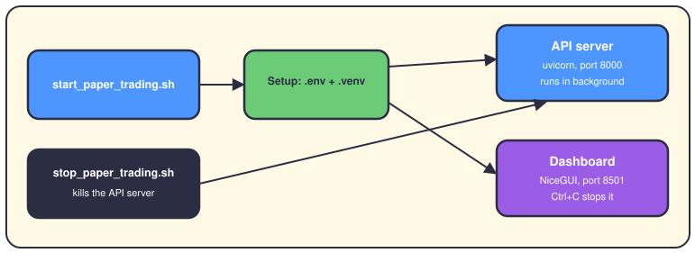

# Order execution and paper trading

## The short version

Execution turns a trading decision into a fill — the moment shares actually change hands. This page follows an order through its states and shows what a fill costs. Then it explains paper trading, where you trade real prices with fake money.

## The life of an order

An order starts as PENDING and becomes SUBMITTED when the system sends it out. The fill — the shares actually bought or sold — can arrive all at once or in pieces. Orders end two ways: you cancel them, or a check fails and the order is REJECTED. These six states come straight from `OrderStatus` in `app/domain/models/order.py`. The broker contract in `app/shared/interfaces/broker_base.py` adds more for live trading, like ACK_RECEIVED, EXPIRED and FAILED.

## From approval to fill

Every fill costs more than the share price. Commission — the broker's fee — defaults to 0.1% of the trade value. Slippage is the gap between the price you wanted and the price you got; the engine estimates it, with 0.05% as the fallback. Market impact is how much your own order pushes the price. SIMPLE mode sets all three to zero; REALISTIC mode charges them. Sometimes only 50–90% of the order fills, and the rest waits.

The paper engine fills your order against live prices and moves fake cash — $100,000 by default. The live path needs a broker adapter, code that talks to a real broker. The repo ships the contract (`broker_base.py`) and a paper broker, so no real broker is wired in yet.

## Paper trading: the two scripts

Run `./scripts/start_paper_trading.sh` and it prepares `.env`, activates `.venv` and starts two services. The API server (uvicorn — the web server behind FastAPI) runs in the background on port 8000. The NiceGUI dashboard runs in the foreground on port 8501, so Ctrl+C stops it. `./scripts/stop_paper_trading.sh` kills the API server using the PID saved in `.api_server.pid`.

## Where it lives in the code

- `app/domain/models/order.py` and `app/domain/models/paper_trading.py` — the order states, `TradeStatus` and the three simulation modes.
- `app/services/paper_trading_service.py` — the paper engine: costs, partial fills, portfolio updates.
- `app/infrastructure/brokers/paper.py` — a small paper broker.
- `app/shared/interfaces/broker_base.py` — the contract every real broker must implement.
- `app/engines/execution_engine/` — microstructure analysis: how to split big orders cheaply.
- `app/simulation/` — order book, matching engine and cost models for rehearsal.
- `scripts/start_paper_trading.sh` and `scripts/stop_paper_trading.sh` — start and stop everything.

## Want to go deeper?

- [The risk engine](06-risk-engine.md) — what must say yes before an order exists.
- [The portfolio](08-portfolio.md) — the cash and positions that execution updates.
- [Backtesting](09-backtesting.md) — the same cost models, replayed on history.
