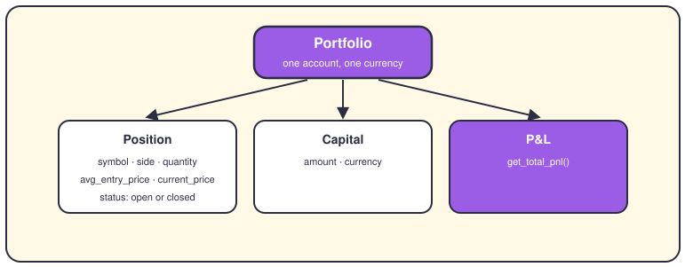
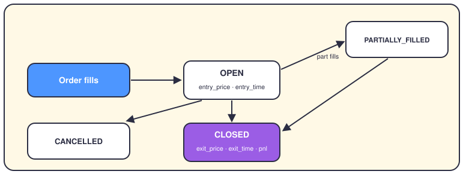
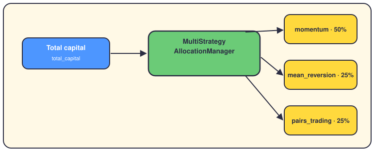

# The portfolio, positions and allocation

## The short version

Your portfolio is one money pot: the cash you have, plus every position you still hold. A position is a bet on one symbol, and it's `open` until you close it. On top sits an allocator that splits the pot between strategies, so no single one eats everything.

## What's inside a portfolio

Here's the real shape of it. The `Portfolio` dataclass keeps a `positions` dict — the key is a symbol, the value is a `Position`. It also holds `capital`, a small value object with an `amount` and a `currency`. Ask for `get_total_value()` and you get cash plus positions; ask for `get_total_pnl()` and you get profit and loss.

Each `Position` tracks its `side` (long or short), `quantity`, `avg_entry_price` and `current_price`. It also remembers `stop_loss`, `take_profit`, plus the highest and lowest price since entry. The portfolio itself has a status: `ACTIVE`, `SUSPENDED`, `FROZEN` or `CLOSED`.

## The life of a position

Trades carry the real state machine, and it lives in `TradeStatus`. A trade starts `OPEN` the moment your order fills. `PARTIALLY_FILLED` means the broker filled only part of it. `CLOSED` sets `exit_price`, `exit_time` and `pnl` — the model rejects a closed trade that's missing them. `CANCELLED` means the order died before filling, so no position was created. A `Position` is simpler: it stays `OPEN` until the last share leaves, then turns `CLOSED`.

## How the money gets split

One class does the splitting: `MultiStrategyAllocationManager`, in `app/services/multi_strategy_allocation.py`. Its default plan gives momentum 50%, mean reversion 25% and pairs trading 25%. The numbers come from the central config, so you can change them without touching code. Each `StrategyCapitalAllocation` also carries a `min_weight` and a `max_weight`.

As results come in, `update_weight()` nudges a strategy's weight and clamps it between those bounds. A second layer, `MultiAssetPortfolioManager`, splits money across asset classes like stocks and bonds. It rebalances when weights drift more than `rebalance_threshold` — 5% by default.

## Where it lives in the code

- `app/domain/entities/portfolio.py` and `app/domain/entities/position.py` — the `Portfolio` and `Position` entities, with their status enums.
- `app/backtesting/models.py` — the canonical `Trade` and `TradeStatus` (`open`, `partially_filled`, `closed`, `cancelled`).
- `app/services/multi_strategy_allocation.py` — `StrategyCapitalAllocation` and `MultiStrategyAllocationManager`.
- `app/domain/portfolio/multi_asset/` — `MultiAssetPortfolio`, `MultiAssetAllocation` and the asset-class rebalancer.
- `app/domain/portfolio_optimization/` and `app/engines/portfolio_engine/` — optimizers (mean-variance, Black-Litterman, hierarchical risk parity) and rebalancers.
- `app/services/portfolio_builder.py`, `portfolio_config_manager.py` and `portfolio_rebalancer.py` — build, configure and rebalance a portfolio.

## Where to go next

- [The life of a trade](02-life-of-a-trade.md) — see the moment a position opens.
- [Strategies](05-strategies.md) — meet the three brains your money feeds.
