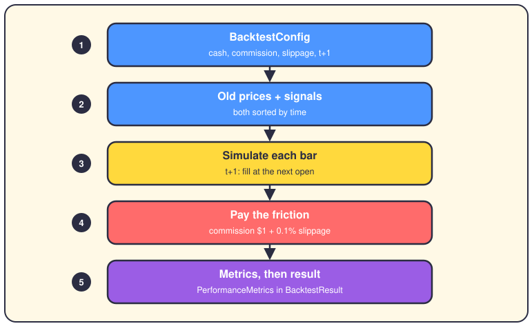
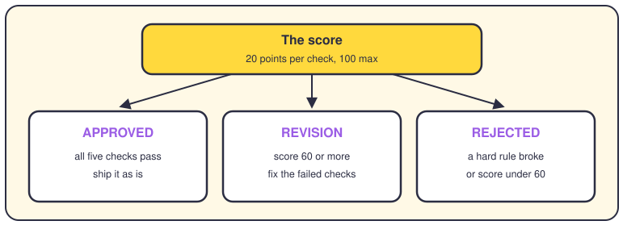
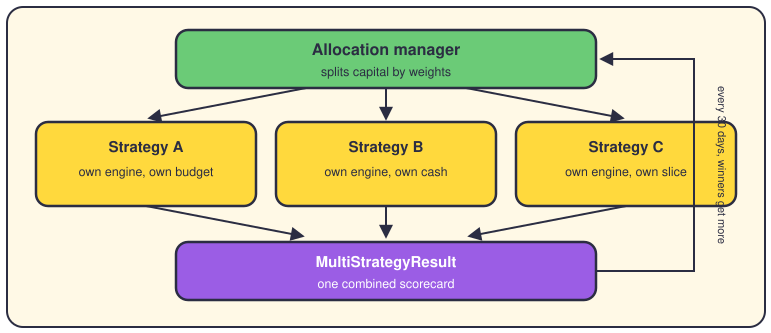

# Backtesting

## The short version

A backtest replays market history to answer one question: would this strategy have made money? You feed it old prices and trading signals, and it simulates every fill with real costs. At the end you get metrics, a score and a verdict — before any real cash moves.

## One run, step by step

The main class is `BacktestEngine` in `engine.py`; older code imports it as `SimpleBacktester`, which is just an alias. Everything starts from a `BacktestConfig`: $100,000 of starting cash, a $1 commission per trade, and 0.1% slippage by default. The engine then walks the bars in time order and matches each signal to the next bar of its symbol.

Here's the honesty rule. A signal born on bar t never fills on that bar. It waits in a queue and fills at the open of the next bar for that symbol. The switch is `next_day_execution`, and it's on by default. Without it, a strategy could trade on a closing price it doesn't know yet. That bug is called look-ahead bias, and it's the classic way backtests lie.

Every fill pays friction, and the engine charges both kinds. Commission is $1 per trade by default, or a percentage if the strategy sets one. Slippage is the gap between the price you want and the price you get — 0.1% by default. Buys fill a bit higher, sells a bit lower, and stops in wild markets fill worse. One shared function, `apply_slippage`, does all of it. There's also a guard: a trade is rejected if its expected profit can't beat five times the round-trip commission.

## The verdict

When the loop ends, `PerformanceMetricsCalculator` turns your trades into numbers: win rate, Sharpe, drawdown, profit factor and friends. They land in a `PerformanceMetrics` object inside a `BacktestResult`. Then the acceptance package plays judge. Five checks run, and each pass adds 20 points to a score that maxes at 100:

- Sharpe over 1.0
- drawdown under 25%
- profit factor over 1.3
- Monte Carlo P5 above -20%
- return beating the benchmark by 3%

The verdict is a real enum in `acceptance/models.py` — APPROVED, REVISION or REJECTED — and REVISION kicks in at a score of 60. Hard rules can still kill a run: if commissions eat over 20% of gross profit, the verdict is REJECTED no matter the score.

## Many strategies, one pot

`MultiStrategyBacktestEngine` runs several strategies side by side on one pot of capital. An allocation manager splits the pot by the weights you set, and each strategy gets its own engine and budget. Every 30 days the `DynamicCapitalReallocationEngine` moves money toward the winners. If the whole portfolio drops 20% early, the run stops. A meta-analyzer can also read many past results and suggest combinations that work well together.

## Where it lives in the code

- `app/backtesting/engine.py` — `BacktestEngine` (alias `SimpleBacktester`): the bar loop, t+1 fills, commission guard.
- `app/backtesting/models.py` — `BacktestConfig`, `BacktestResult`, `PerformanceMetrics`, `Trade`.
- `app/backtesting/shared/slippage_utils.py` — the one slippage formula every engine shares.
- `app/backtesting/acceptance/` — `VerdictDeterminer`, `ScoringService`, and the states in `models.py`; thresholds in `acceptance_criteria.py`.
- `app/backtesting/engines/multi_strategy_engine.py` — `MultiStrategyBacktestEngine`; `meta_analyzer/` sits nearby.

## Want to go deeper?

- [The data pipeline](04-data-pipeline.md) — where the old prices come from.
- [Strategies](05-strategies.md) — who generates the signals you're replaying.
