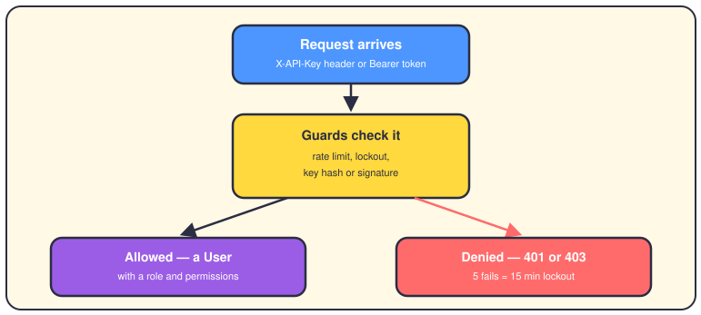
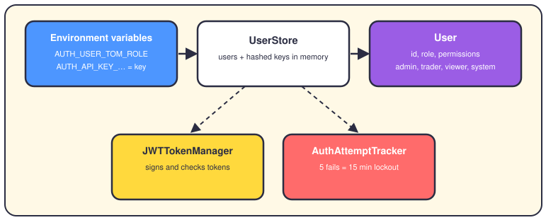
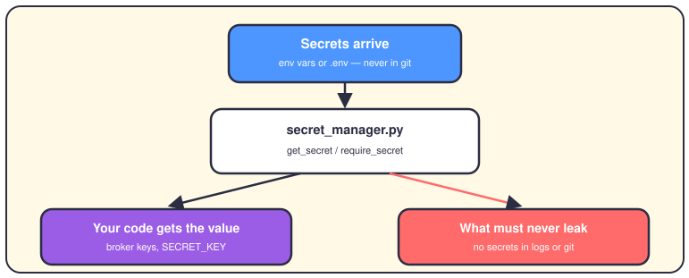

# Security and authentication

## The short version

Every request to the API has to prove who sends it. You prove that with an API key (a long password sent in a header) or a JWT (a signed ticket that expires). The system checks the proof before it touches any money, and it locks you out if you fail too often.

## One request's journey

A request comes in with a key in the `X-API-Key` header or a token in the `Authorization` header. The `AuthAttemptTracker` counts your tries first: more than 20 a minute, or a fresh lockout, and you're out. The key path hashes your key — a hash is a one-way scramble — and looks for a match among stored hashes. The token path checks the JWT signature and its expiry date, using a secret only the server knows. Win either check and you become a `User` with a role (your job title) and permissions (what you may do). Lose and you get a 401 or 403 error. Five failures lock that caller out for 15 minutes.

## Who's allowed to do what

No user lives in the code. At startup, `UserStore` reads `AUTH_USER_*` and `AUTH_API_KEY_*` variables from the environment. Each key is hashed with HMAC-SHA256 before it's stored, so the plain key only ever sits in your environment. A `User` has one role: admin, trader, viewer or system. Admins pass every role check, and endpoints pick their guard — `get_trader_user` for trading, `get_admin_user` for admin jobs. There's also a CSRF guard for browser forms: a CSRF token is a one-time code that proves a form came from your own site.

## Where the secrets live

Secrets are the passwords the system uses: broker keys, database URLs, the `SECRET_KEY` that signs tokens. They arrive as environment variables or through a `.env` file, and `.gitignore` keeps that file out of git. `get_secret` reads one and masks it in logs, so you see `sk_1***` instead of the real value. `require_secret` refuses to start in production when a needed secret is missing. Nothing secret is hardcoded, and logs get masked — that's the whole rule.

## Where it lives in the code

- `app/security/authentication/auth.py` — the door checks: `get_current_user`, `get_admin_user`, `require_roles`.
- `app/security/authentication/user_store.py` — `UserStore`: users and hashed keys, loaded from env vars.
- `app/security/authentication/jwt_token_manager.py` and `auth_attempt_tracker.py` — tokens, lockouts, rate limits.
- `app/security/authentication/user.py` — the `User` class and the four roles.
- `app/security/secrets/secret_manager.py` — `get_secret`, `require_secret`, `mask_secret`.
- `app/presentation/api/middleware.py` — `AuthMiddleware` and `SecurityHeadersMiddleware`, wired up in `app/main.py`, plus CSRF guards in `app/security/web_security/`.

## Want to go deeper?

- [How the system works](01-how-the-system-works.md) — where this front door sits in the layer cake.
- [The folder map](03-folder-map.md) — what lives in every folder inside `app/`.
- [Execution](07-execution.md) — the endpoints where the trader role matters.
