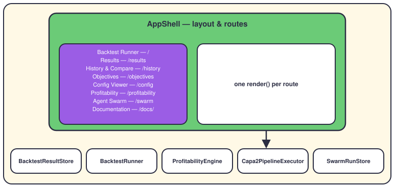
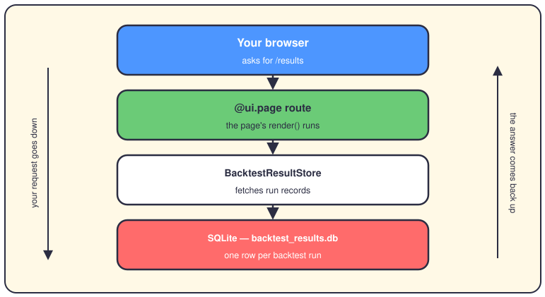
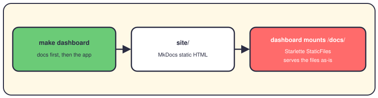

# The backtesting dashboard

## The short version

The dashboard is a small web app that rides on top of your backtests. NiceGUI (a Python library that turns plain functions into web pages) draws every screen. You pick a strategy, run a test, and read the verdict — no terminal needed.

## The shell and its drawer

`create_app()` builds five shared services and injects them into `AppShell`. The shell draws the drawer, the header, and one route per page. The drawer isn't hardcoded — it's built from the `PAGES` list in `theme.py`, so navigation and routes can't drift apart. Each page module exposes a `render()` function and takes only the services it needs.

## What happens when you open a page

NiceGUI turns each `@ui.page` function into a real URL. When your browser asks for `/results`, that function runs. It calls `BacktestResultStore`, which reads rows from SQLite (a database that's just one file on disk). When a backtest finishes, `BacktestRunner` saves one row to the same file. That's why the History page can compare runs from last week.

## The docs live inside it

`make dashboard` runs `mkdocs build` before it starts the app. MkDocs turns the markdown in `docs/` into static HTML (files that need no server code) under `site/`. The dashboard mounts that folder at `/docs/`, and `html=True` makes `/docs/` open the index page. So this very page ships inside the app at `http://localhost:8503/docs/`. Skip the build and you still get a page — it just tells you to run `make docs-build`.

## Where it lives in the code

- `app/presentation/dashboard/nicegui_app/app.py` — `create_app()`: builds the services, injects them, mounts `/docs`.
- `app/presentation/dashboard/nicegui_app/layout.py` — `AppShell`: the drawer (from the `PAGES` list in `theme.py`) and every `@ui.page` route.
- `app/presentation/dashboard/nicegui_app/pages/` — one `render()` module per page.
- `app/presentation/dashboard/nicegui_app/__main__.py` — `ui.run()`; the port comes from the `DASHBOARD_PORT` env variable, 8503 by default.
- `Makefile` — `make dashboard`: docs build first, then the app, on port 8503.
- `scripts/start_paper_trading.sh` — starts the same app beside paper trading, with `DASHBOARD_PORT=8501`.

## Want to go deeper?

- [Backtesting](09-backtesting.md) — what the runner actually computes.
- [The folder map](03-folder-map.md) — where everything else in `app/` lives.
- [How the system works](01-how-the-system-works.md) — the big picture, layer by layer.
