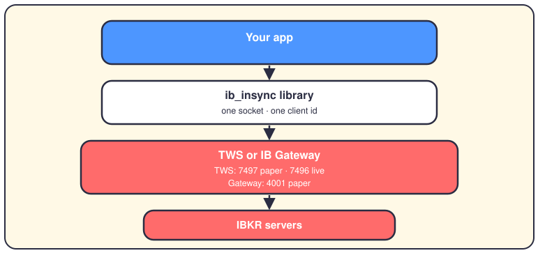
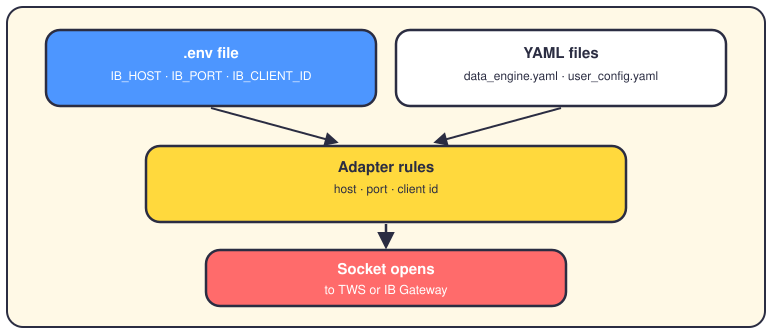
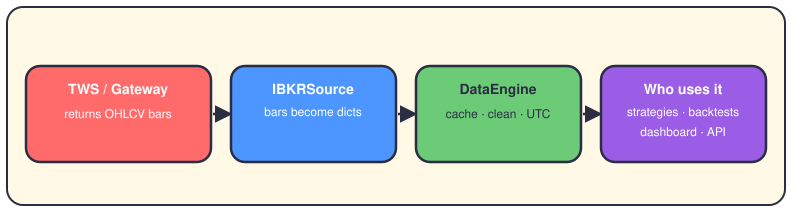

# The Interactive Brokers connection

## The short version

Interactive Brokers (IBKR) is the outside broker this repo can talk to. Your code never calls IBKR's servers directly — it opens a local socket to TWS or IB Gateway, the desktop app you log into. The price-feed code is real and working. The order code exists too, but it isn't wired into live trading yet.

## The road to IBKR

All traffic goes through one Python library: `ib_insync` (the repo pins `ib-insync>=0.9.86`). It speaks the TWS API, IBKR's protocol, over a TCP socket. But the socket stops on your machine. TWS (Trader Workstation) is IBKR's full trading desktop; IB Gateway is the stripped-down version that only relays traffic. You must run one of them, log in, and switch on its API — `docs/user/PAPER_TRADING.md` lists the clicks. Paper accounts use port 7497 with TWS, or 4001 with IB Gateway; live accounts use 7496. The desktop app then carries every request to IBKR's servers. If it isn't running, connect fails — that's the number one gotcha.

## Where the settings come from

Settings live in two places. The adapters read the environment variables first — those win. The YAML files feed the data engine and the user settings instead. On a broken link, the adapters retry up to ten times, doubling the wait from 1 s to 60 s.

The real names, with their defaults:

- `IB_HOST` — where TWS or IB Gateway listens. Default `127.0.0.1`, your own machine.
- `IB_PORT` — the socket port. Default `7497`, TWS paper. Live TWS uses `7496`.
- `IB_CLIENT_ID` — a number that keeps two of your scripts from fighting. Default `1`.
- `IB_ACCOUNT`, `IB_PAPER_TRADING` — account code (the example is `DU9811225`) and the paper flag, `True` by default.
- `TIMEOUT_IB_CONNECT`, `TIMEOUT_IB_READ` — give up after 15 and 30 seconds.
- `config/market/data_engine.yaml`, key `ibkr:` — ports `7497`/`7496`, client id, bar size `1 day`.
- `config/user_config.yaml`, key `broker_settings:` — `ibkr_host`, `ibkr_port: 4001`, `ibkr_client_id`; `broker_type` defaults to `paper`.

## What comes back

You ask for a symbol, a date range and a bar size, from `1 min` up to `1 day`. IBKR answers with OHLCV bars: open, high, low, close and volume for each slice of time. `IBKRSource` wraps every bar in a dict of `Decimal` numbers, so float noise can't touch your prices. The DataEngine checks its cache first (Redis or PostgreSQL), fills gaps, drops outliers and normalizes timestamps to UTC. Then strategies, backtests and the API read the clean rows. Two limits: the source only requests US stocks in USD through SMART, IBKR's route across exchanges. And `useRTH=True` means regular trading hours only — no pre-market bars.

## What the app does with it

On the data side, IBKR is one feed among four. If you don't name a source, the engine tries Polygon, then Alpaca, then Binance, then IBKR — the last resort. It's also opt-in: the engine only builds `IBKRSource` when your config has an `ibkr` block under `sources.ohlcv`, and the shipped yaml doesn't. On the order side there's real code but no wiring. `IBKRSpainAdapter` places market, limit and stop orders, cancels them, and reads your account — in EUR, with IBEX 35 contracts. Only the unit tests call it today. `BrokerConnector`, the class that picks your live broker, throws an error if you ask for IBKR: it refuses to fall back to paper quietly. So live orders go through paper or Alpaca, and backtests use `config/brokers/interactive_brokers.yaml` as a pure cost model — commissions, fees, spreads, slippage.

## What's real and what isn't

- Real: the historical-bars feed. Connect, download, convert — it works once TWS or IB Gateway runs with the API on.
- Real but idle: both order adapters, tested yet unreached. The older `ib_adapter.py` even streams live quotes with a five-second cache.
- Refused on purpose: `BrokerConnector` plus IBKR raises an error instead of quietly trading paper. Fail-closed by design.
- Stub: the options source logs "requires TWS, not implemented yet" and stays offline; the backtest loader names `ibkr` but rejects it too.
- Config ahead of code: `production.yaml` calls IBKR the primary broker. The connector doesn't agree yet.

## Where it lives in the code

- `app/engines/data_engine/sources/ohlcv_sources.py` — `IBKRSource`, the historical-bars feed.
- `app/engines/data_engine/data_engine.py` and `config_loader.py` — source registration, fallback order, port defaults.
- `app/services/live_trading/broker_adapters/ibkr_adapter_spain.py` and `ibex35_contracts.py` — orders and account, EUR, IBEX 35.
- `app/services/live_trading/broker_adapters/ib_adapter.py` — the older adapter, with live quotes.
- `app/services/live_trading/broker_connector.py` — picks your broker; refuses IBKR for now.
- `config/market/data_engine.yaml`, `config/user_config.yaml`, `config/brokers/interactive_brokers.yaml` — engine ports, user settings, backtest costs. TWS setup steps live in `docs/user/PAPER_TRADING.md`.

## Want to go deeper?

Next stops: [the data pipeline](04-data-pipeline.md), [execution](07-execution.md), and [the life of a trade](02-life-of-a-trade.md).
