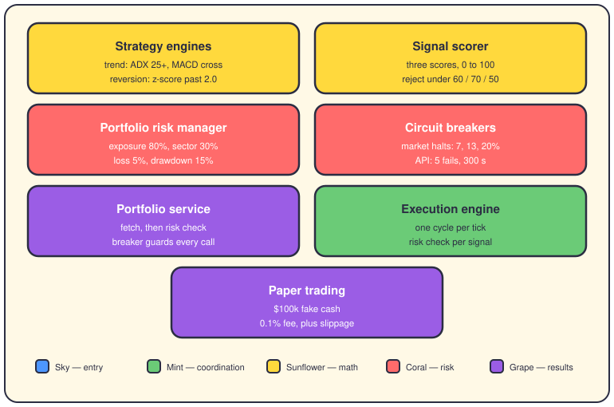
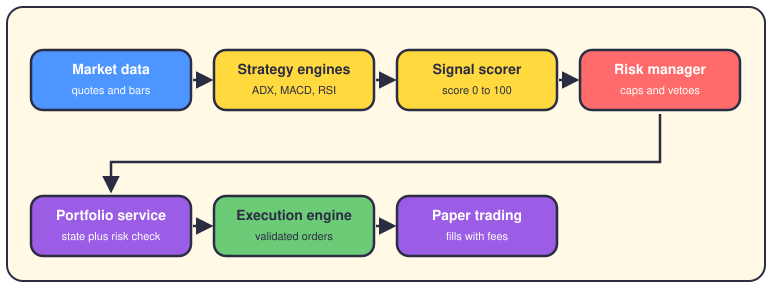

# The component playbook

## The short version

Every trade passes through a handful of named components, and each one runs a small, knowable strategy. This page is a card for each: its job, its real numbers from the config, and its place in the line.

## The map

Color is the layer, like on page one. Yellow computes, red guards, purple keeps the books, green runs the show. Read left to right, top to bottom — that's roughly the order work flows.

## The pipeline

A price tick enters on the left and either dies at a gate or becomes a paper fill on the right. Every arrow is a rejection point. Most ideas don't get past the scorer.

## Strategy engines — the analyst

There's no class named `TechnicalAnalyst` in this repo; the strategy engines play that part, in `app/engines/strategy_engines/`. `TrendFollowingStrategyEngine` buys when ADX (a trend-strength gauge) is over 25 and MACD (12/26/9) crosses up. Volume must be at least 1.2x its 20-bar average. `MeanReversionStrategyEngine` computes a z-score — how far the price sits from its own mean, in deviations — and buys under -2.0. Both get indicators from `TechnicalIndicatorCalculator`, a thin wrapper over `TechnicalIndicators`, which also does RSI: period 14, under 30 oversold, over 70 overbought. Inputs are quotes plus 200-bar history buffers; the output is a `Signal`.

## SignalScorerService — the grader

`SignalScorerService` in `app/services/signal_scorer.py` delegates the math to `SignalEvaluationEngine`. Every idea gets three scores from 0 to 100: strength, confidence, and liquidity. Strength blends volatility (60%) with volume ratio (40%); confidence blends data quality (70%) with trend consistency (30%). The combined score weights them 40% strength, 40% confidence, and 20% liquidity. A signal survives only if strength is at least 60, confidence at least 70, and liquidity at least 50. Those floors are the defaults in `TradingThresholds`. Survivors land in a priority queue of 1,000, and a 10-minute cooldown (`signal_cooldown_minutes`) stops the same symbol from spamming.

## PortfolioRiskManager — the risk boss

The risk job has no plain `RiskManager` class; it's `PortfolioRiskManager` in `app/services/portfolio_risk_manager.py`. Its `assess_portfolio_risk` measures total exposure, per-sector exposure, pairwise correlations, daily loss, drawdown, volatility, and currency exposure. A violation fires when exposure passes 80% or a sector passes 30%. A correlation above 0.7, daily loss past 5%, or drawdown past 15% fires too. Severity then sets the level: any critical violation means CRITICAL, a high one (or three medium) means HIGH, one medium means MEDIUM. It also owns the tripwires at 5% daily loss, 10% drawdown, and 5% volatility, and caches correlation results for one hour.

## CircuitBreakerManager — two referees, one name

Two different classes carry this exact name, and they guard different things. The one in `app/services/api_circuit_breaker.py` guards API calls: five failures open the circuit, calls stop for 300 seconds, then three half-open successes close it. It runs four of them — API errors, data service, order execution, broker connection. The one in `app/services/circuit_breaker_manager.py` watches the market itself. It tracks SPY every 30 seconds and maps drops of 7%, 13%, and 20% to Level 1, 2, and 3 halts. A VIX reading of 25 logs a warning; 35 pauses all trading, with auto-resume once the halt lifts.

## PortfolioService — the keeper

`PortfolioService` in `app/services/portfolio_service.py` wraps a `PortfolioProvider` and never trusts it blindly. Every fetch first checks whether the API circuit breaker is open; if it is, you get `None` back instead of an error storm. Each successful fetch is followed by a full `PortfolioRiskManager` assessment, so the risk level stays fresh. It also owns the `CurrencyHedgingEngine` and the sector and country diversification validators. Adding a position runs the risk assessment with that position included, before anything moves.

## ExecutionEngine — the runner

The runner lives in `app/domain/strategies/execution_engine.py`. Its `run_cycle` asks the registry for the active strategy, calls `generate_signals`, then runs `risk_check` on each signal. Signals that pass get logged and returned; the rest are rejected with a reason. A second class with the same name sits in `app/domain/engines/execution_engine.py` and picks how an order goes out: MARKET, LIMIT, TWAP, VWAP, or ICEBERG. TWAP spreads an order over time, VWAP tracks the day's average price, and ICEBERG hides the true size.

## PaperTradingService — the dress rehearsal

`PaperTradingService` in `app/services/paper_trading_service.py` trades real prices with fake money — and charges you for it. The default config starts with $100,000 and a 100 ms delay. It charges a 0.1% commission, 0.05% slippage and 0.01% market impact, with no partial fills. Position size is capped at 50% of equity; the daily loss and drawdown limits (5% and 15%) come straight from the trading config. `_can_execute_trade` checks cash, the position cap, and both loss limits before anything fills. In REALISTIC mode, slippage is added to the fill price — buys pay more, sells get less. Portfolios, sessions, and trades live in memory, so a restart wipes the slate.

## Where it lives in the code

- `app/engines/strategy_engines/` — trend, momentum, mean reversion, breakout, pairs, and arbitrage engines; indicators come from `app/domain/services/analysis/momentum.py`.
- `app/services/signal_scorer.py` and `app/services/signal_evaluation_engine.py` — scoring service and its math; cooldown and queue in `app/services/signal_scoring_engine.py`.
- `app/services/portfolio_risk_manager.py` — limits, violations, and risk levels.
- `app/services/api_circuit_breaker.py` and `app/services/circuit_breaker_manager.py` — both breaker managers.
- `app/services/portfolio_service.py` — the portfolio keeper.
- `app/domain/strategies/execution_engine.py` and `app/domain/engines/execution_engine.py` — both execution engines.
- `app/services/paper_trading_service.py` — the simulation.
- `app/shared/config/trading_config.py` — most defaults quoted on this page.

## Want to go deeper?

- [Strategies](05-strategies.md) — the engines in detail, one page per idea.
- [Risk engine](06-risk-engine.md) — the limits and what trips them.
- [Execution](07-execution.md) — how a validated signal becomes an order.
