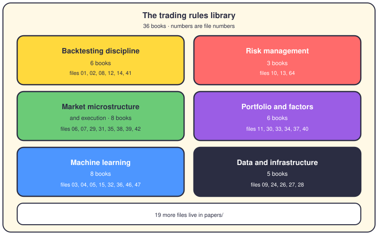

# The trading rulebook

## The short version

`config/rules/trading/` is the rules library: one markdown file per trading book, 36 of them at the top level. Each file turns one book's ideas into short, blunt orders written for the AI coding agents. Agents read them before coding; reviewers check new work against them.

The number in each heading below is the file number, so `config/rules/trading/13-*.md` is John Hull. The rules inside the files are written in Spanish; here they are in English, three or four per book.

## The bookshelf

## Backtesting discipline
### 1. Ernest Chan — Algorithmic Trading
- Never use future data in a decision made today (look-ahead bias).
- Reject any strategy whose worst drawdown passes 25%.
- Risk at most 2% of capital per trade, sized with a cautious Kelly formula.
- Slippage and the bid-ask spread go into the backtest, always.
### 2. Ernest Chan — Quantitative Trading
- Backtest on five years of data or more, and test in several markets.
- Split walk-forward tests 70/30 and touch the held-out set once.
- Cap tunable parameters at three or four.
- Mean reversion needs a half-life under one year — verify with a stationarity test.

Compliance doc: `docs/developer/ERNEST_CHAN_QUANTITATIVE_TRADING.md`.
### 8. Gregory Zuckerman — The Man Who Solved the Market
- The process beats the model — test everything before production.
- Strategies decay: monitor signal strength and retire weak ones automatically.
- Never iterate on the test set; combine weak models into ensembles instead.
### 12. Antti Ilmanen — Expected Returns
- Prove each strategy across many periods and many assets.
- Detect the market regime, then shift strategy weights to match it.
- Steady performance beats the best single run (the meta-rule).
### 14. Tomasini and Jaekle — Designing Trading Systems
- One shared event-driven interface serves backtest and live trading.
- Signal code never places trades — that job belongs to the order layer.
- Keep config outside code, log in a structured way, persist state across restarts.
### 41. Robert Pardo — Evaluation and Optimization of Trading Strategies
- Walk-forward: optimize on 70%, validate on 30%, roll the window, repeat.
- Accept at most 30% decay between in-sample and out-of-sample results.
- Run 1000+ shuffled-trade Monte Carlo runs; the p95 drawdown must stay under 30%.

## Risk management
### 10. Robert Carver — Systematic Trading
- Size positions for a target risk first; returns come second.
- Diversify across instruments and keep the trading rules simple.
- Trading costs enter every calculation; sturdiness beats raw performance.
### 13. John Hull — Risk Management and Financial Institutions
- The kill switch is mandatory: halt at 20% drawdown or 5% daily loss.
- Risk overrides alpha, every time.
- Track VaR and expected shortfall, stress-test correlations, cap each instrument.
- Circuit breakers and volatility targeting are design parts, not extras.
### 64. Realistic Retail Trading Rules
- Never risk more than 2% per trade, and demand a 2:1 reward-to-risk ratio.
- Correlated positions count as concentration — cap them together.
- Scale capital in phases: from 1k to 10k, then 50k, then 500k.

## Market microstructure and execution
### 6. Larry Harris — Trading and Exchanges
- Read the order book before you send anything into it.
- Bid-ask bounce is noise; don't trade it as signal.
- Model market impact with Almgren-Chriss, and never assume unlimited liquidity.

Compliance doc: `docs/developer/HARRIS_TRADING_AND_EXCHANGES.md` — see it in code: `app/simulation/order_book.py`.
### 7. Maureen O'Hara — Market Microstructure Theory
- Liquidity first: judge depth, not just the best quote.
- Measure order-flow toxicity and avoid trading against informed flow.
- The spread is information; latency between signal and fill changes outcomes.
### 29. Barry Johnson — Algorithmic Trading and DMA
- Model market impact as a power function of order size.
- Slice large orders with adaptive TWAP and iceberg entries.
- Route smartly, hide your intent, track fill rates, re-peg when the book moves.
### 31. Brent Donnelly — The Art of Currency Trading
- Check the economic calendar and the session before any FX trade.
- Range markets reward mean reversion — trade the range, not the trend.
- Time of day, month-end flows, and Friday logic all move currencies.
### 35. Irene Aldridge — High-Frequency Trading
- Detect adverse selection before it picks you off.
- Order-flow imbalance predicts short moves; filter the bid-ask bounce first.
- Scale inventory risk down as it grows, and screen out spoofing.
### 38. Steffensen et al. — Automated Market Makers
- Automated market makers price by constant product — respect the formula.
- Buffer for impermanent loss before you provide any liquidity.
- Watch the CEX-DEX price gap, gas costs, and sandwich attacks.
### 39. Sasha Stoikov — Market Making in Crypto
- Close each session near flat inventory (closing the loop).
- Skew quotes with inventory, the Avellaneda-Stoikov way.
- Ladder the book, capture funding, and respect tail risk, liquidation hunts, peg breaks.
### 42. Robert Kissell — Algorithmic Trading and Portfolio Management
- Estimate impact before trading, from order size over daily volume.
- Urgent orders execute at arrival price; patient orders work toward VWAP.
- Participate at 10-20% of volume, slice parents into children, review every fill.

## Portfolio and factors
### 11. Gray and Vogel — Quantitative Momentum
- Skip the newest month when measuring momentum — it mean-reverts.
- Rank stocks on risk-adjusted momentum, relative to their sector.
- Screen for quality, rebalance monthly, and size by momentum rank.
### 30. Berkin and Swedroe — Factor-Based Investing
- Screen for quality: profitability, stable earnings, capped payout ratios.
- Combine value and momentum in one multifactor score.
- Rebalance on drift with sector caps, liquidity filters, and Spanish taxes in mind.
### 33. Andrew Ang — Asset Management
- Think in factors, not in assets.
- Rebalance on volatility and watch downside correlations, not average ones.
- Illiquidity pays a premium — hold it only when you can carry it.
### 34. Meb Faber — Shareholder Yield
- Total yield equals dividends plus buybacks minus new share issuance.
- Avoid yield traps: check debt load and cash-flow consistency first.
- Backtests include taxes; yields move with interest rates.
### 37. Ashraf Laidi — Intermarket Analysis
- Gold leads the Australian dollar; oil leads the Canadian dollar.
- Yield gaps and the dollar index anchor every FX view.
- Read central bank language with NLP; let the VIX filter risk appetite.
### 40. Grinold and Kahn — Active Portfolio Management
- The fundamental law: skill times the square root of independent bets.
- Shrink alphas before optimizing, and cap turnover and position size.
- Choose your neutrality — dollar, beta, or sector — and hold it.

## Machine learning
### 3. Marcos López de Prado — Advances in Financial Machine Learning
- Meta-labeling: the model sizes the trade, it doesn't only pick direction.
- Purge and embargo overlapping samples; plain KFold is banned on time series.
- Fractional differentiation keeps memory while making data stationary.

Compliance doc: `docs/developer/LOPEZ_DE_PRADO_95_COMPLIANCE.md` — see it in code: `app/backtesting/labeling/meta_labeling_cv.py`.
### 4. Marcos López de Prado — Machine Learning for Asset Managers
- Denoise correlation matrices with random matrix theory, then detone the market factor.
- Hierarchical risk parity beats mean-variance on stability.
- Validate that portfolio weights stay steady out of sample.
### 46. Marcos López de Prado — Machine Learning for Asset Managers, part 2
- Cluster assets first, then optimize inside each cluster (NCO).
- Blend market equilibrium with your own views (Black-Litterman).
- When return forecasts are weak, fall back to minimum variance or risk parity.
### 5. Rishi Narang — Inside the Black Box
- Keep the alpha model, risk model, cost model, and execution separate.
- The risk model caps factor exposures; the cost model splits commission, spread, impact.
- No market orders past 1% of daily volume — large orders work to VWAP.

Compliance doc: `docs/developer/NARANG_INSIDE_BLACK_BOX_IMPLEMENTATION.md` — see it in code: `app/strategies/alpha_models.py`.
### 15. Hastie, Tibshirani and Friedman — The Elements of Statistical Learning
- Regularization is mandatory: shrinkage, every model, every time.
- Cross-validate the right way and tune hyperparameters only inside validation.
- Check learning curves and the bias-variance tradeoff before trusting a fit.

Compliance doc: `docs/developer/STATISTICAL_LEARNING_HASTIE_COMPLIANCE.md` — see it in code: `app/backtesting/validation/cross_validation_methods.py`.
### 32. Ruey Tsay — Analysis of Financial Time Series
- GARCH captures volatility clustering — use it for stops and sizing.
- Fat tails are the norm; adjust risk numbers for them.
- Re-test stationarity and cointegration as relationships drift over time.
### 36. Al Brooks — Price Action Trends
- Count bars (H1, H2, L1, L2) to grade a trend's health.
- Failed breaks make the best trap trades; climax bars warn of turns.
- These patterns become ML features: opening ranges, measured moves, support flips.
### 47. Nicholas Chan — Machine Learning for Time Series
- Enforce stationarity (ADF, KPSS) — usually by working with returns.
- Ignoring autocorrelation inflates your Sharpe ratio; test for it.
- Split by time, never at random, and retrain as you walk forward.

## Data and infrastructure
### 9. Yves Hilpisch — Python for Algorithmic Trading
- Vectorize with NumPy and pandas — no row-by-row loops in hot paths.
- Cache expensive calculations and use Numba where speed matters.
- Backtests run in parallel with multiprocessing; handle missing data cleanly.
### 24. Python Concurrency with AsyncIO
- No blocking calls inside async code — `requests` and `time.sleep` are out.
- Shield critical orders from cancellation and wrap every API call in a timeout.
- Heartbeat your WebSockets, use semaphores for rate limits, shut down gracefully.
### 26. Martin Kleppmann — Designing Data-Intensive Applications
- Event sourcing gives the audit trail; write-ahead logs power recovery.
- Under CAP, trading chooses consistency over availability.
- Make every write idempotent and read under snapshot isolation.
### 27. Andriy Burkov — Machine Learning Engineering
- One central feature store serves every model.
- Version each model with its metadata and metrics.
- Ship via shadow mode and canaries; watch concept and data drift.
### 28. Jean-Philippe Aumasson — Serious Cryptography
- No secrets in code — environment variables, validated at startup.
- Hash passwords with bcrypt or argon2; sign API requests with HMAC.
- TLS everywhere, JWT for auth, certificate pinning for broker connections.

## Where it lives

- `config/rules/trading/` — the 36 rules files, one per book, written in Spanish.
- `config/rules/trading/papers/` — 19 more files distilled from research papers (Markowitz, Fama-French, Avellaneda-Stoikov).
- `docs/developer/` — the compliance guides for Chan, Harris, López de Prado, Narang, and Hastie.

**Read next:** [Backtesting](09-backtesting.md) · [The risk engine](06-risk-engine.md) · [The engineering rulebook](21-engineering-rules.md)
