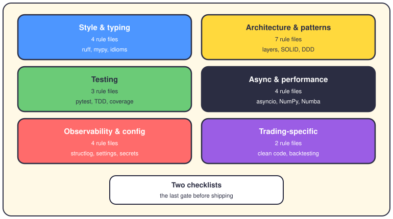

# The engineering rulebook

## The short version

`config/rules/python/` holds 26 files that say how this project writes Python. Each file covers one topic, with right and wrong code side by side. This page catalogs them by theme, so you find the rule before you write the wrong thing.

## The map

## Style and typing

### 01. Formatting and style

- 100 characters per line, maximum. The formatter decides, not you.
- Imports sit in three blocks: standard library, third party, local.
- No mutable default arguments, like `def f(items=[])`.
- Enforced by: ruff and ruff-format (pre-commit hooks), plus `make lint` and `make format`.

### 02. Type hints

- Every function gets hints, for parameters and the return type.
- Modern syntax only: `str | None`, not `Optional[str]`. `Protocol` over `Any`, which needs a justify-comment.
- Enforced by: mypy on `app/` (`make lint`, `make type-check`) — not full strict mode yet.

### 17. Fluent Python, the idioms

- Data classes with `__slots__` for ticks and quotes.
- Anything that opens and closes becomes a context manager.
- Comprehensions beat loops. Strategies are functions you pass around.

### 22. Fluent Python, advanced idioms

- `__slots__` on a tick class saves about 40 percent of the RAM.
- Signals are `dataclass(frozen=True)` — immutable, safe to share across tasks.
- Generators for tick streams: one tick in memory at a time.
- Enforced by: mypy, for the typing rules (`Final`, `Literal`).

## Architecture and patterns

### 03. SOLID principles

- One class, one reason to change.
- Extend by adding new code, not by editing old code.
- A subclass must keep its parent's promises.
- Business logic depends on abstractions, never directly on databases.

### 04. Design patterns

- Factory and Builder for creation. Singleton for config.
- Adapter to wrap a broker API you can't change.
- Strategy and Observer for behavior that swaps at runtime.

### 05. Architecture and clean code

- Four layers: domain, application, infrastructure, presentation.
- The domain layer imports nothing from the outside world.
- DRY, KISS, YAGNI — repeat nothing, keep it simple, build nothing early.
- Small functions, domain-based names, shallow nesting. Composition over inheritance.

### 10. Advanced patterns

- Thread-safe singletons, typed factories, fluent builders.
- A generic Repository sits between services and SQLAlchemy.
- Named anti-patterns: god objects, singleton abuse, premature abstraction.

### 11. Enterprise architecture

- Domain: entities, value objects, domain exceptions.
- Application: use cases with a Command/Result shape, DTOs at the edges.
- Infrastructure: repositories and clients with retries. Presentation: thin FastAPI endpoints.

### 16. Cosmic Python (DDD)

- The domain defines ports; infrastructure supplies the adapters.
- Repository and Unit of Work wrap all persistence.
- A message bus carries commands and events. Views stay thin.

### 18. Clean Architecture

- Folder names should shout the domain, not the framework.
- Dependencies point inward: the domain depends on nobody.
- DTOs cross boundaries. ORM models never do.
- `main.py` is the only place that assembles the whole system.

## Testing

### 06. Testing standards

- Every test follows AAA: arrange, act, assert.
- Parametrize one test instead of copying it five times.
- Mock the world outside, not the code under test.
- Enforced by: pytest (`make test`) and the coverage gate — `make test-cov` fails under 80 percent.

### 15. Testing, the long version

- Test names read as sentences about behavior.
- Builders make test data, not walls of literals.
- Clear slots for async, integration, contract and smoke tests.

### 21. TDD for financial systems

- Red, green, refactor — in that order, every time.
- A bug gets its regression test first, then its fix.
- Floats compare with a tolerance, never with `==`.
- Enforced by: pytest; the 80 percent coverage gate matches the file's own rule.

## Async and performance

### 07. Async patterns

- No blocking calls inside an async function. Ever.
- Connections use async context managers, so they always close.
- Fan out with bounded concurrency, not with unbounded tasks.

### 13. Async patterns, part two

- The sync-to-async bridge wraps blocking libraries in an executor.
- Errors inside gathered tasks get collected and logged, not swallowed.
- Async tests get their own discipline, separate from sync ones.

### 19. High Performance Python

- Profile first. cProfile names the slow function before you guess.
- asyncio for waiting; multiprocessing for computing.
- Numba or Cython for the hot core. Zero-copy `memoryview` for sockets. `__slots__` for millions of objects.

### 23. Performance, the sharp rules

- `for` loops over price arrays are banned — vectorize with NumPy.
- `pandas.apply()` is banned for the same reason.
- Numba `@jit(nopython=True)` compiles recursive indicators. py-spy profiles live.
- Enforced by: `make perf-test` runs `tests/performance/`.

## Observability and config

### 08. Configuration

- One Pydantic Settings class, not `os.environ` reads scattered around.
- One `.env` file per environment. Validate at startup, not later.
- Secrets never live in code or in a committed `.env` file.
- Enforced by: detect-secrets and bandit, both pre-commit hooks, plus `make security`.

### 09. Logging and observability

- structlog emits JSON. `print()` is not logging.
- Bind context once per request — order id, user id — not once per line.
- Exceptions log their full traceback, at the level they mean.

### 12. Logging and observability, part two

- Prometheus metrics, defined once, instrumented everywhere.
- Timing decorators measure slow spans; health checks prove the real dependencies, not just the process.

### 14. Configuration management, part two

- Validators check URLs and database settings on boot.
- Production secrets come from a manager (Vault-style), encrypted.
- Dynamic settings can reload without a restart.

## Trading-specific

### 25. Clean code for trading

- Pydantic validates every object entering the system.
- An `Order` doesn't know how to send itself.
- Directions are enums, not the strings "BUY" and "SELL".
- No bare `except Exception`. One strategy instance per trading pair.

### 50. Backtesting framework rules

- Ten backtest types, from baseline to Monte Carlo and regime tests.
- Walk-forward and out-of-sample runs guard against overfitting.
- Silent killers: leaked resources, NaN data, non-idempotent runs.
- Classic traps: look-ahead bias, survivorship bias, ignored costs.

## The two checklists

### 00. The QA checklist

- One page of checkboxes, run before anything reaches production.
- Covers format, types, docs, security, quality and testing, in that order.
- Coverage above 80 percent. Complexity under 10.
- Enforced by: mirrors `make lint`, `make test-cov` and `make security`.

### 19. The enterprise checklist

- The same gates as 00, plus async, config, logging and performance sections.
- Ends with a CI pipeline example and the pre-commit setup to copy.
- Yes, two files carry the number 19: this checklist and the performance digest.

## Where it lives

- `config/rules/python/` — all 26 rule files, named `NN-topic.md`.
- `.pre-commit-config.yaml` — ruff, ruff-format, bandit, detect-secrets and friends, run on every commit.
- `Makefile` and `pyproject.toml` — the commands (`make lint`, `make test`, `make security`) and the settings they read.

## Want to go deeper?

- [The developer's hat](16-hat-developer.md) — where to write code, day to day.
- [The folder map](03-folder-map.md) — what lives in each `app/` folder.
- [The trading rules](20-trading-rules.md) — the market-side rulebook; this page is the code-side one.
