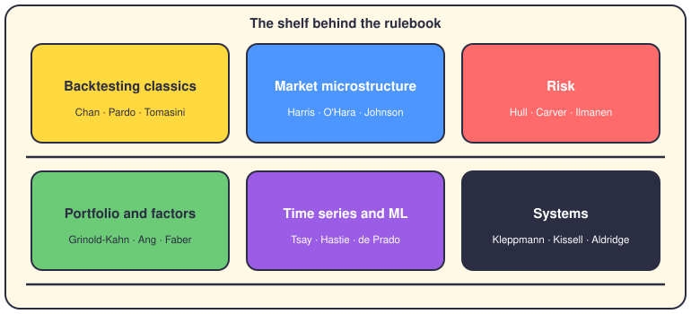

# The bibliography behind the rules

## The short version

None of the rules in this repo came from thin air. Each numbered file in `config/rules/trading/` is one book, turned into do-and-don't clauses. This page lists every book, what the app took from it, and where that lives in the code.

## The shelf, in six schools

## Backtesting classics

### Ernest P. Chan — "Algorithmic Trading" (rule 01)

The book that demands honest backtests. The app took its bans on look-ahead bias and free fills: you pay the full spread and only know what was knowable then. It also added a cointegration test before any pairs trade, and half-Kelly position caps. Lives in `config/rules/trading/01-ernest-chan-algorithmic-trading.md`.

### Ernest P. Chan — "Quantitative Trading" (rule 02)

Treats trading as a business you measure. The app took the mean-reversion half-life cap (under one year, via an AR(1) fit) and walk-forward optimization. This one has a [compliance doc](../developer/ERNEST_CHAN_QUANTITATIVE_TRADING.md) mapping it to `app/services/factor_models.py`, `app/services/optimization_chan.py`, `app/services/regime_detection_chan.py` and `app/services/execution_algorithms.py`.

### Robert Pardo — "The Evaluation and Optimization of Trading Strategies" (rule 41)

A book about proving a strategy survives unseen data. The app took walk-forward testing: optimize on 70 percent, validate on 30 percent, and reject when results degrade too much. Also parameter sweeps of ±20 percent and Monte Carlo drawdown checks. Lives in `config/rules/trading/41-pardo-evaluation-optimization-trading-strategies.md`.

### Tomasini & Jaekle — "Designing Trading Systems" (rule 14)

Two authors who insist the backtest and the live bot share one architecture. The app took the event-driven shape: market events, signal events, order events, one interface for both worlds. Lives in `config/rules/trading/14-tomasini-jaekle-designing-trading-systems.md`.

## Market microstructure

### Larry Harris — "Trading and Exchanges" (rule 06)

The textbook on how exchanges actually match orders. The app took price-time priority, call auctions, and a full trading cost breakdown. The [compliance doc](../developer/HARRIS_TRADING_AND_EXCHANGES.md) maps it to `app/simulation/order_book.py`, `market_mechanics.py`, `exchange.py`, `trading_costs.py` and `microstructure.py`.

### Maureen O'Hara — "Market Microstructure Theory" (rule 07)

Says liquidity is a promise a market can break. The app took the habit of checking volume, spread and depth before any trade, plus informed-trading detection. It lives in `app/microstructure/` — order flow, liquidity, price discovery and trading mechanisms (see the [quick reference](../developer/quick_references/OHARA_MICROSTRUCTURE_QUICK_REFERENCE.md)).

### Barry Johnson — "Algorithmic Trading and DMA" (rule 29)

Direct market access, explained order by order. The app took his quadratic impact model: cost grows faster than linearly as your order grows against daily volume. Estimate the impact before you send, not after. Lives in `config/rules/trading/29-barry-johnson-algorithmic-trading-dma.md`.

### Steffensen et al. — "Automated Market Makers" (rule 38)

About DEX pools like Uniswap and Curve. The app took the constant product formula, x·y=k, to price slippage before any swap. Lives in `config/rules/trading/38-steffensen-automated-market-makers.md`.

### Sasha Stoikov — "Market Making in Crypto" (rule 39)

Market making earns the spread; it should not bet on direction. The app took the zero-inventory target: end each hour close to flat. Lives in `config/rules/trading/39-sasha-stoikov-market-making-crypto.md`.

## Risk and survival

### John Hull — "Risk Management and Financial Institutions" (rule 13)

Institutional risk control, from Value at Risk to liquidity. The app took the kill switch: a hard stop at 20 percent drawdown plus a daily loss limit. His rule is blunt — no kill switch, no production. Lives in `config/rules/trading/13-john-hull-risk-management.md`.

### Robert Carver — "Systematic Trading" (rule 10)

A former fund manager's case for rules over opinions. The app took "size after the signal": every signal becomes a position through a volatility target, capped per position. Lives in `config/rules/trading/10-robert-carver-systematic-trading.md`.

### Antti Ilmanen — "Expected Returns" (rule 12)

A tour of where returns really come from, and how thin they are. The app took the multi-regime test: a strategy must work in several periods and several assets, or it is rejected. Lives in `config/rules/trading/12-antti-ilmanen-expected-returns.md`.

### Gregory Zuckerman — "The Man Who Solved the Market" (rule 08)

The Renaissance story, and proof that process beats any single genius idea. The app took automated strategy reviews: anything with a weak 30-day Sharpe gets switched off by a script, not a mood. Lives in `config/rules/trading/08-zuckerman-man-solved-market.md`.

### Brent Donnelly — "The Art of Currency Trading" (rule 31)

A practitioner's forex book. The app took the economic calendar filter: go flat around NFP, CPI and rate decisions. Lives in `config/rules/trading/31-brent-donnelly-art-of-currency-trading.md`.

## Portfolio and factors

### Grinold & Kahn — "Active Portfolio Management" (rule 40)

The standard reference on quant fund math. The app took the fundamental law (IR equals IC times the square root of breadth), the transfer coefficient, and alpha shrinkage. Lives in `config/rules/trading/40-grinold-kahn-active-portfolio-management.md`.

### Berkin & Swedroe — "Factor-Based Investing" (rule 30)

Which factors earned their keep over decades. The app took the quality screen: check that ROE is stable or rising before you chase a dividend. Lives in `config/rules/trading/30-berkin-swedroe-factor-based-investing.md`.

### Gray & Vogel — "Quantitative Momentum" (rule 11)

Momentum works, but only after you clean it. The app took multi-window momentum: combine 1, 3, 6 and 12 month looks, normalized. Lives in `config/rules/trading/11-gray-vogel-quantitative-momentum.md`.

### Andrew Ang — "Asset Management" (rule 33)

Argues you manage factors, not asset labels. The app took the factor exposure view: fifty tech stocks is one bet, not diversification. Lives in `config/rules/trading/33-andrew-ang-asset-management.md`.

### Meb Faber — "Shareholder Yield" (rule 34)

Dividends are only one way a company pays you back. The app took total yield: dividends plus buybacks plus debt paydown. Lives in `config/rules/trading/34-meb-faber-shareholder-yield.md`.

### Ashraf Laidi — "Intermarket Analysis" (rule 37)

Reads forex through linked markets: gold, oil, bonds. The app took the gold/AUD divergence check as a signal input. Lives in `config/rules/trading/37-ashraf-laidi-intermarket-analysis.md`.

## Time series and machine learning

### Ruey Tsay — "Analysis of Financial Time Series" (rule 32)

The statistics of prices over time. The app took GARCH(1,1) volatility forecasts for crypto and FX, plus dynamic cointegration re-tests for pairs. Lives in `config/rules/trading/32-ruey-tsay-analysis-financial-time-series.md`.

### Hastie, Tibshirani & Friedman — "The Elements of Statistical Learning" (rule 15)

The machine learning theory book. The app took its discipline: proper cross-validation, regularization, and bias-variance checks that reject needless complexity. The [compliance doc](../developer/STATISTICAL_LEARNING_HASTIE_COMPLIANCE.md) maps it to `app/backtesting/validation/cross_validation_methods.py`, `app/strategies/momentum_modular/learning/regularization.py` and `app/backtesting/ensemble_methods.py`.

### Marcos López de Prado — "Advances in Financial Machine Learning" (rule 03)

Why naive machine learning fails on financial data. The app took triple-barrier labels, purged cross-validation, uniqueness-weighted feature importance, and meta-labeling; the meta-model probabilities then size bets in `app/services/position_sizing_engine.py`. Full maps: [compliance doc](../developer/LOPEZ_DE_PRADO_95_COMPLIANCE.md) and [meta-labeling integration](../developer/META_LABELING_POSITION_SIZING_INTEGRATION.md).

### Marcos López de Prado — "Machine Learning for Asset Managers" (rules 04 and 46)

A shorter, meaner follow-up. The app took Hierarchical Risk Parity for allocation and random matrix theory to denoise correlation matrices; HRP runs inside `app/services/optimization_chan.py`. Rule 04's file name says Stefan Jansen, but its header cites this book.

### Nicholas Chan — "Machine Learning for Time Series" (rule 47)

Stationarity first, models second. The app took stationarity tests (ADF, KPSS), temporal train-test splits, and ARIMA/GARCH baselines. Lives in `config/rules/trading/47-chan-machine-learning-time-series.md`.

### Al Brooks — "Trading Price Action Trends" (rule 36)

Charts read as a sequence of highs and lows. The app took bar counting: H1, H2, L1 and L2 become input features for the ML models. Lives in `config/rules/trading/36-al-brooks-price-action-trends.md`.

## Systems and engineering

### Martin Kleppmann — "Designing Data-Intensive Applications" (rule 26)

How big systems stay correct under failure. The app took event sourcing for the audit trail, plus replication and partitioning patterns. Lives in `config/rules/trading/26-ddia-data-intensive-trading.md`.

### Robert Kissell — "Algorithmic Trading and Portfolio Management" (rule 42)

Execution as its own discipline. The app took pre-trade impact estimates (impact scales with size over ADV), the full transaction cost stack, and implementation shortfall measurement. Lives in `config/rules/trading/42-kissell-algorithmic-trading-portfolio-management.md`.

### Irene Aldridge — "High-Frequency Trading" (rule 35)

What HFT does to your fills. The app took adverse selection detection: if your orders only fill when the market moves against you, stop. Lives in `config/rules/trading/35-irene-aldridge-high-frequency-trading.md`.

### Rishi K. Narang — "Inside the Black Box" (rule 05)

Dissects a quant fund into alpha, risk, portfolio and execution modules. The app took that split almost literally; the [compliance doc](../developer/NARANG_INSIDE_BLACK_BOX_IMPLEMENTATION.md) maps it to `app/strategies/alpha_models.py`, `app/services/risk_models_narang.py`, `app/services/portfolio_construction.py` and `app/services/execution_narang.py`.

### Yves Hilpisch — "Python for Algorithmic Trading" (rule 09)

Python that survives production. The app took the vectorize-everything rule: NumPy and Pandas, no unexplained loops. Lives in `config/rules/trading/09-yves-hilpisch-python-algo-trading.md`.

### Matthew Fowler — "Python Concurrency with asyncio" (rule 24)

Hundreds of sockets, one event loop. The app took async WebSockets, no blocking calls in the loop, and graceful shutdown. Lives in `config/rules/trading/24-asyncio-concurrency-trading.md`.

### Andriy Burkov — "Machine Learning Engineering" (rule 27)

Shipping ML without chaos. The app took the feature store, versioned experiments, model monitoring, and canary releases. Lives in `config/rules/trading/27-mlops-trading-lifecycle.md`.

### Jean-Philippe Aumasson — "Serious Cryptography" (rule 28)

Security for people who ship code. The app took secret management, input validation, and audit logging. Lives in `config/rules/trading/28-security-and-secrets.md`.

## Not a book, but on the same shelf

Rule 64, "Realistic Retail Trading Rules", is house wisdom, not a book. It came from `gemini_rules.txt` and sets the survival goal: grow 1000€ to 500k with fractional Kelly sizing. Lives in `config/rules/trading/64-realistic-retail-trading-rules.md`.

## Reading order

- Chan, "Algorithmic Trading" (rule 01) — honest backtests come before anything else.
- Hull, "Risk Management and Financial Institutions" (rule 13) — the kill switch mindset. Survive first.
- Carver, "Systematic Trading" (rule 10) — a signal is nothing without sizing.
- Harris, "Trading and Exchanges" (rule 06) — why every fill costs more than the chart suggests.
- López de Prado, "Advances in Financial Machine Learning" (rule 03) — for when ML enters the house.

## Want more?

- [The trading rules](20-trading-rules.md) — the rules themselves, one by one.
- [The engineering rules](21-engineering-rules.md) — the systems side of this shelf.
- [The quant hat](17-hat-quant.md) — how the quant puts these books to work.
