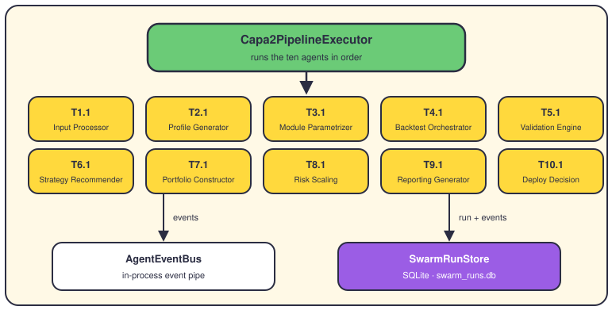
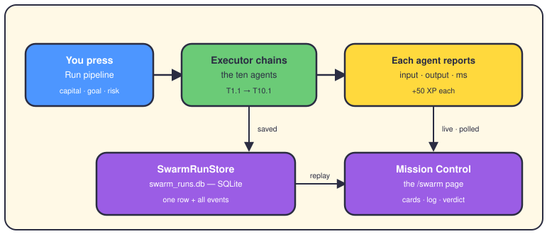
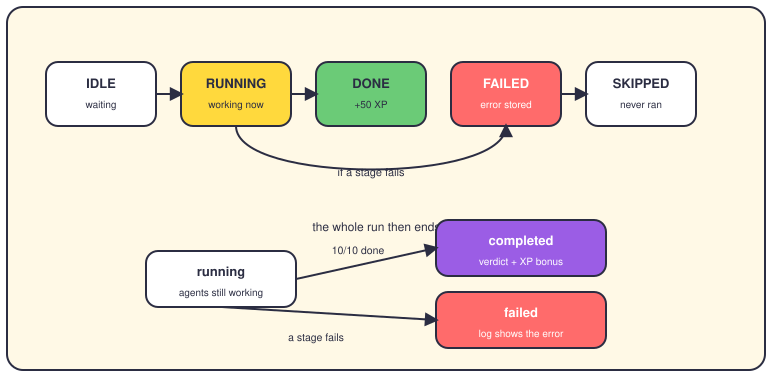

# The Agent Swarm and Mission Control

## The short version

The Agent Swarm is a friendly costume for the CAPA 2 pipeline. CAPA 2 is the system's parametrization workflow: it turns your capital, goal and risk level into a final deploy decision. The swarm dresses its ten steps as "agents" with names, colors and status bubbles. Mission Control is the dashboard page (`/swarm`) where you launch a run and watch those agents work. Nothing here is simulated — each agent calls the real component, in order, in about a second.

## The swarm: ten agents and two helpers

Each agent is one real CAPA 2 component — the same code the API uses. The executor (Capa2PipelineExecutor) is the coordinator: it builds each agent's input, awaits it, and checks the result. The event bus is a small in-process pipe; every step publishes a message there. The store writes each run to SQLite, so nothing is lost when the page closes.

What the ten agents do, in their own plain words from the UI:

- **T1.1 Input Processor** — checks that capital, goal and time frame make sense.
- **T2.1 Profile Generator** — builds your investor profile and picks the modules.
- **T3.1 Module Parametrizer** — tunes each module's parameters for that profile.
- **T4.1 Backtest Orchestrator** — replays one year of history (AAPL, MSFT, GOOGL).
- **T5.1 Validation Engine** — checks the gates: costs, capital, feasibility.
- **T6.1 Strategy Recommender** — scores strategies and recommends the best fit.
- **T7.1 Portfolio Constructor** — splits capital across the enabled modules.
- **T8.1 Risk Scaling** — adjusts for market regime, volatility and drawdown.
- **T9.1 Reporting Generator** — writes the report: rating, strengths, weaknesses.
- **T10.1 Deploy Decision** — the verdict: APPROVED, CONDITIONAL or REJECTED.

It works like a relay race: the output of one agent becomes the input of the next. If a stage fails or crashes, the run stops there and every remaining agent is marked SKIPPED. Each finished stage pays 50 XP (experience points — a game score), and a full run adds a 100 XP bonus. Achievements also come from real outcomes: feasibility gate passed, deploy approved, clean run with no warnings.

## The journey of one mission

You fill in four things on the left: capital, goal, risk level and time frame. Advanced options add a monthly target, the market regime and the volatility level. Press Run pipeline (or ALT+R) and the executor starts. The page polls the run every 250 ms, but redraws only when a version counter has moved — that counter bumps on every event. Click any step to see exactly what went in and what came out, as JSON.

The result card explains the verdict in plain words, with the key numbers next to it. Technical detail hides behind a disclosure: a terminal-style execution log and a bar chart of step durations. History & replay lists past runs; pick one, set a speed, and watch it again (ALT+P). One small drift: the quickstart still calls the button "Launch Mission"; the page says "Run pipeline" today.

## What gets saved

The store (SwarmRunStore) is an async wrapper around SQLite, a single-file database. The file is `swarm_runs.db` at the repo root — `DEFAULT_SWARM_DB_PATH` in the code. It opens in WAL mode (write-ahead logging), so the dashboard and the API can share it safely. Two tables:

- `swarm_runs` — one row per mission: status, request, timestamps, total XP, achievements, results.
- `swarm_events` — one row per event, with a type like `stage_completed` and its JSON payload.

The API endpoint `POST /capa2/complete-workflow` uses the same executor and the same file. So a run started from code lands in the same history as one started from the page.

## The states of a run

Each agent moves through five statuses: IDLE, RUNNING, DONE, FAILED or SKIPPED. The whole run has three: `running`, `completed` or `failed`. These exact words come from the code — the page just colors them.

## Where it lives in the code

- `app/services/agent_swarm/executor.py` — `Capa2PipelineExecutor`, `AGENT_SPECS` (the ten agents), `SwarmRunRequest`, XP constants.
- `app/services/agent_swarm/store.py` — `SwarmRunStore` and `DEFAULT_SWARM_DB_PATH` (repo-root `swarm_runs.db`).
- `app/services/agent_swarm/events.py` — the eight event types and the `AgentEventBus`.
- `app/services/agent_swarm/serialization.py` — `safe_json`, which turns any payload into readable JSON.
- `app/presentation/dashboard/nicegui_app/pages/swarm.py` — Mission Control itself: form, cards, log, replay.
- `app/presentation/dashboard/nicegui_app/components/agent_card.py` and `components/mission_log.py` — the step rows and the terminal log.
- `app/presentation/controllers/capa2_endpoints.py` — `POST /capa2/complete-workflow`, the API door into the same executor.

One neighbor is easy to mistake for swarm code: `components/run_comparison.py` compares two backtest runs for the History & Compare page. It has nothing to do with swarm missions.

## Want to go deeper?

- [The dashboard](11-dashboard.md) — the `/swarm` page in the context of the whole app.
- [Backtesting](09-backtesting.md) — what T4.1 actually replays.
- [The component playbook](13-component-playbook.md) — the logic each of the ten agents applies.
