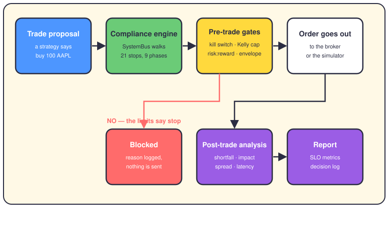
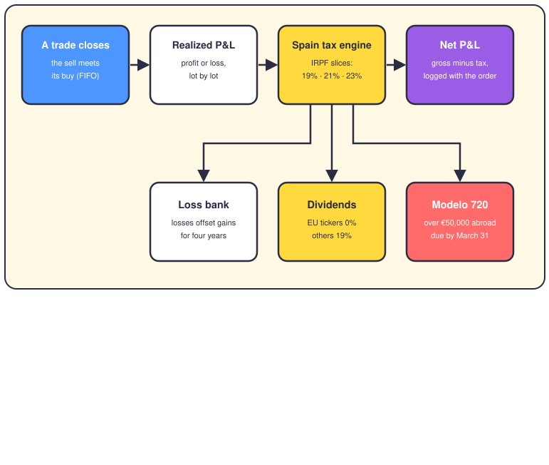

# Compliance and taxes: the referee and the tax office

## The short version

Before any order leaves this system, one engine gets a veto. The compliance engine checks every trade against a kill switch, size caps, and risk limits. If something smells wrong, the trade is blocked and the reason is logged. After the trade, the same engine grades how well it was executed.

Then there's the money you may owe Spain. When a trade closes, the Spain tax engine works out the tax on your profit, using Spanish rates. It also banks losses you can reuse, and it watches the €50,000 foreign-asset report you might owe Hacienda.

## The flow: one proposal, many referees

Every proposal enters through `analyze_pre_trade`, and the kill switch runs first. Lose more than 5% of the day's starting capital and every trade is blocked until the tracker resets.

Then the `SystemBus` walks 21 stops in nine fixed phases: data, context, risk, strategies, microstructure, portfolio, execution, trading checks, and architecture. Three stops are critical — `risk_engine`, `data_engine`, and `live_trading`. If one of those fails, `can_execute` flips to false and the trade dies with a logged reason.

The live-trade path adds gates with real numbers. The Kelly cap says an order can't risk more than 2% of the portfolio. The risk:reward gate wants at least twice the reward for the risk taken. The envelope caps exposure at 30% per symbol, 80% per strategy, and 95% in total.

If the order leaves, the grading starts. `analyze_post_trade` measures implementation shortfall — the gap between the price you saw and the price you got. It also measures market impact, timing cost, and latency against a 100 ms promise. Everything lands in the decision log, so anyone can ask "why?" later.

There's a second, smaller referee set. `OrderPatternAnalyzer` watches for manipulative habits like layering and spoofing — fake orders meant to fool other traders. `ComplianceManager` also keeps the US-only rules, the PDT rule and wash sales, behind a country flag. Spain has neither rule.

## The tax flow: from closed trade to net profit

Spain's tax office doesn't care how long you held a position. A gain held for ten seconds is taxed like one held for ten years. There's no US-style long-term rate, and no wash sale rule.

When you sell, shares are matched to buys with FIFO — first in, first out. The match produces a realized profit or loss. Profit is taxed in slices: 19% on the first €6,000, 21% up to €50,000, and 23% above that. A loss pays no tax; it's banked instead, and it can offset gains for the next four years.

Dividends get a simpler test in the wired-in engine: a curated list of EU tickers pays 0% withholding, everything else pays 19%. Foreign holdings add paperwork. Above €50,000 abroad, you owe Hacienda a yearly Modelo 720 report, due by March 31. Crypto holdings get their own yearly form, Modelo 721.

The result rides on `TradeResult` as `spain_tax`, and net profit is simply gross minus tax. One caveat: at order time the engine books zero profit, so the real tax lands when fills settle.

Sharp eyes will find two Spain engines. The one wired into trading, `SpainTaxEngineImpl`, uses the €6,000 and €50,000 slices above. The factory engine uses higher slice limits, roughly €33,000 and €53,400. `SPAIN_TAX_ENGINE.md` documents the factory one, so the doc and the trade path disagree. Trust the code you actually run.

## Rule 28

Rule 28 is the security half of compliance, and its demand is blunt. No key, password, or token ever lives in source code. Secrets come from environment variables, documented in `.env.example`, masked in logs, and rejected when they look weak. Connection strings are built at runtime, never typed in. The doc claims a manager at `app/core/secret_manager.py` plus a validation script. The real manager sits at `app/security/secrets/secret_manager.py`, and that script doesn't exist — the doc drifted, the idea held.

## Where it lives in the code

- `app/services/compliance/compliance_engine.py` — the engine itself: `SystemBus`, kill switch, risk envelope, position sizing, SLO tracking.
- `app/services/compliance/manager.py` — country rules, with `pdt_tracker.py`, `wash_sale_tracker.py`, and `order_pattern_analyzer.py` beside it.
- `app/domain/services/compliance/` — the refactored split: pre-trade checker, post-trade checker, service registry.
- `app/services/tax_efficiency/engines/spain_tax_engine_impl.py` — the Spain engine wired into `execute_trade`.
- `app/services/tax_efficiency/engines/spain_tax_engine.py` and `factory.py` — the config-driven engine and its factory.
- `app/services/fifo/` — FIFO lot matching and the Modelo 721 crypto report.
- `app/shared/protocols/i_spain_tax_engine.py` — the five-method contract every Spain engine signs.
- `app/shared/config/params/risk_config.py` — every threshold on this page, as named config.
- `docs/sre/SECURITY_COMPLIANCE_RULE28.md` and `docs/sre/SPAIN_TAX_ENGINE.md` — the deeper docs, partly stale.

## Want to go deeper?

- [The life of a trade](02-life-of-a-trade.md) — where these gates sit in the trading loop.
- [The risk engine](06-risk-engine.md) — the limits that feed the compliance gates.
- [Security](19-hat-security.md) — the keys, secrets, and audits behind Rule 28.
