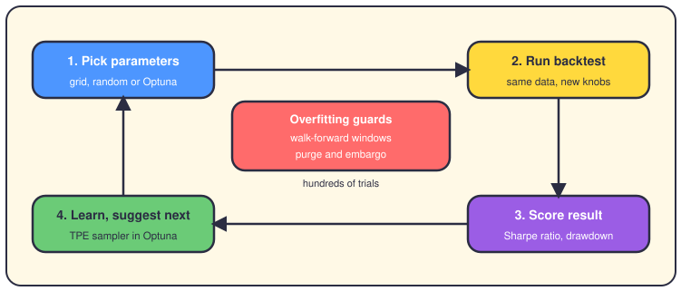
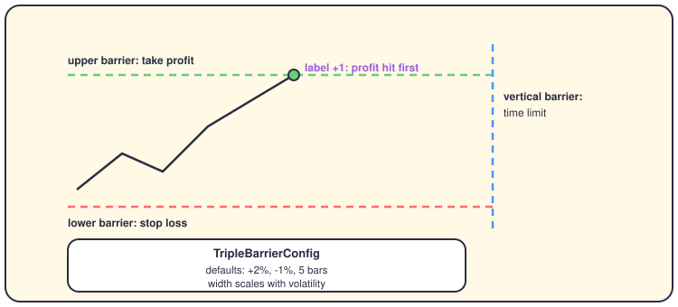
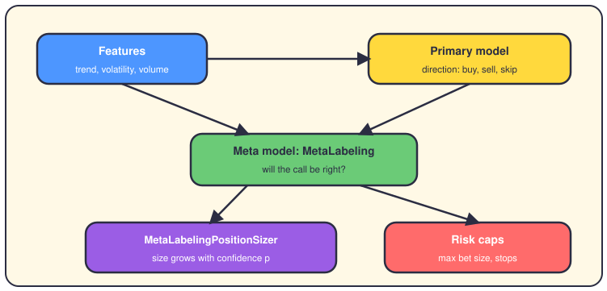

# Strategy optimization, meta-labeling and walk-forward

## The short version

Optimization means trying many parameter sets for a strategy and keeping the best one. A parameter is a knob, like a lookback window of 20 days. The danger is overfitting: you tune the knobs so well to past noise that live results disappoint. This repo fights back with three tools. Labeling turns past prices into clean teaching examples. Meta-labeling adds a second model that decides how much to bet. Walk-forward keeps checking that your gains survive on data the tuner never saw.

## The loop, and the guards around it

Three engines can drive the loop. Grid search tries every combination you list. Random search samples combinations. The Bayesian optimizer uses Optuna and learns from past trials where the good values hide. Without Optuna installed, it falls back to random search.

**The guards matter more than the engine.** Walk-forward splits history into windows: tune on 24 months, test on the next 6, then roll forward and repeat. Purging deletes training samples whose outcome still overlaps the test window. An embargo adds a small gap after each test window. Together they stop the tuner from peeking at the future, which is exactly what overfitting feeds on. The backtest optimizer also applies a Bonferroni correction, a penalty you pay for testing many variants at once.

**A scorer decides when to stop.** `RobustnessScorer` blends consistency, parameter stability, sensitivity and in-sample versus out-of-sample decay into one score from 0 to 100. You need 80 or more to pass; 60 to 79 means watch it closely, and below that the run fails.

## Labels first: the triple barrier

Before any model learns, raw prices must become labels, short answers like "this moment was a good buy". The code uses the triple barrier method from López de Prado's book.

Each event gets three barriers: profit above, stop below, and time on the right. Whichever barrier the price hits first decides the label. Barriers scale with volatility, so wild assets get wider stops. These labels feed the learning strategies, which also weight samples by uniqueness for overlapping events.

## Meta-labeling: direction versus size

Asking one model both when to trade and how big is a lot to ask. Meta-labeling splits the job in two, and the repo has a real pipeline for it.

The primary model keeps direction: buy, sell or skip. The meta model reads the same features plus the primary call, and estimates the chance that call is right. The Kelly rule f = 2p - 1 turns that chance p into a fraction of your capital. Confidence of 0.55 gives a small bet; strong confidence gives a big one, capped by risk limits. Weak signals get skipped entirely.

## What's real, what's planned

**Real today.** Everything above exists in the codebase with tests. `triple_barrier.py` runs inside the supervised learning engine. The compliance engine and `position_sizing_engine.py` can both call the meta-labeling code. Walk-forward exists in two places: the validator under `app/backtesting/validation/` and `ParameterOptimizationService`. `BacktestMetaAnalyzer` clusters past results, and `LearningEngineStorage` saves model weights safely, without pickle.

**Planned, not wired in.** The default live sizing path is still ATR and Kelly, without meta-labels. The integration doc lists what comes next: portfolio-level meta-models, regime-aware confidence thresholds, ensemble meta-models, online learning, and drawdown-based sizing. Treat those as roadmap, not shipped features.

## Where it lives in the code

- `app/domain/optimization/` — the optimizers: `bayesian_optimizer.py` (Optuna), `grid_search_optimizer.py`, `factory.py`, plus `robustness_scorer.py` and `parameter_stability_metrics.py`.
- `app/domain/portfolio_optimization/` — a different beast: weights across assets, not strategy knobs (mean-variance, Black-Litterman, NCO).
- `app/backtesting/labeling/` — `triple_barrier.py`, `meta_labeling.py`, `bet_sizing_meta.py`, `concurrent_training.py`.
- `app/backtesting/validation/` — `walk_forward.py`, `cross_validation.py` (purged CV with embargo), `parameter_stability.py`.
- `app/backtesting/walk_forward_validator.py` — the bigger validator, with stress tests and Monte Carlo runs.
- `app/backtesting/meta_analyzer/` — `meta_analyzer.py`, `audit_trail.py`, `learning_storage.py`.
- `app/services/position_sizing_engine.py` — `PositionSizingEngine` and `MetaLabelingPositionSizer`.

## Go deeper

- [Backtesting](09-backtesting.md) — the sandbox all of this runs in.
- [The strategies](05-strategies.md) — the strategies whose knobs get tuned.
- [The bibliography](22-bibliography.md) — where the López de Prado ideas came from.
