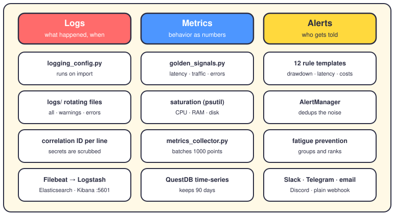
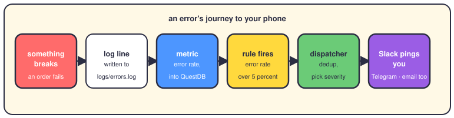

# Observability: logs, metrics and alerts

## The short version

Observability means you can ask the system a question and get an answer without writing new code. Questions like "why did we sell AAPL at 14:02?" or "is the robot even alive?"

The repo answers them with three tools. Logs record what happened, one line at a time. Metrics turn behavior into numbers you can chart. Alerts poke you when a number goes where it shouldn't. One of the three runs by default; the other two you switch on yourself.

## The three pillars

**Logs — the diary.** Every warning and error lands in rotating files under `logs/`: `all.log` for INFO and up, plus separate `warnings.log` and `errors.log`. Each line gets a correlation ID — a short tag that ties every line of one request together — and timing in milliseconds. A filter scrubs passwords and API keys before they touch disk, so secrets never reach the files.

For real searching, the repo ships an ELK stack in `docker-compose.logging.yml`. Filebeat tails the log files, Logstash enriches each line, Elasticsearch indexes them, and Kibana gives you search at `localhost:5601`. Metricbeat adds host CPU and RAM; Curator deletes old data. It's opt-in — start it with `docker compose -f docker-compose.logging.yml up -d`.

**Metrics — the numbers.** Two collectors feed the pillar. `golden_signals.py` tracks Google SRE's four health signals: latency (how slow), traffic (how busy), errors (how many fail) and saturation (how full the machine is). Saturation comes from psutil, which reads CPU, RAM and disk straight from the OS. Trading numbers flow through `metrics_collector.py` into QuestDB — a database built for timestamped numbers, called a time-series database. It batches up to 1000 points per write and keeps 90 days.

**Alerts — the phone call.** The `AlertingOrchestrator` wires four pieces together: a rule engine, an alert manager, a metrics alerter and a notification dispatcher. Twelve rule templates ship by default. Three templates watch drawdown at 5, 10 and 15 percent; 15 halts trading. Then come a volatility spike, cost overruns, a Sharpe drop and two or four losses in a row. The last three watch the machine: fill ratio under 95 percent, latency over a second, and error rate over 5 percent.

The manager dedups — dedup means one incident makes one alert, not fifty copies. Fatigue prevention then groups and ranks what reaches you. Five channels can deliver: Slack, Telegram, Discord, email over SMTP, and a plain webhook.

## From break to your phone

The loop runs once a minute by default: the alerter queries the metrics, the rules vote, and matching rules raise alerts through the dispatcher. The webhook URL comes from the `ALERT_WEBHOOK_URL` environment variable, which `config/environments/production.yaml` wires in. No URL set, the channel stays silent.

Two watchdogs sit beside the loop. A dead man's switch flips if the system goes quiet — no heartbeat means something ate the process. And the toil tracker in `app/sre/automation/` logs how many minutes humans spend on manual work, so you can prove what deserves automating.

## What runs today

File logging is wired: `logging_config.py` configures itself the moment it's imported, so the `logs/` files always exist. The rest is opt-in. Nothing in `app/main.py` starts the ELK stack, QuestDB writes or the alert loop. The production dashboard accepts an orchestrator, and the error-budget code expects one, but you have to hand it over. The full chain works; you just flip the switches.

## Where it lives in the code

- `app/infrastructure/logging/logging_config.py` — file logging, correlation IDs, secret scrubbing. Always on.
- `app/infrastructure/logging/trading_decision_logger.py` — a dedicated diary for every trade decision.
- `app/services/centralized_logging.py` — service-level structured logs for the ELK pipeline.
- `docker-compose.logging.yml` and `logging/` — the ELK stack and its Elasticsearch, Logstash, Kibana and Filebeat configs.
- `app/sre/monitoring/` — `golden_signals.py` and `trading_metrics.py`.
- `app/services/metrics_database/` — `questdb_connector.py`, `metrics_collector.py`, `metrics_query_engine.py`.
- `app/application/alerting/alerting_orchestrator.py` — the conductor that starts and stops the alert loop.
- `app/services/alerting_system/` — `rule_templates.py` (the 12 rules) and `notification_channels.py` (the five channels).
- `app/sre/alert_fatigue_prevention/` and `app/sre/dead_mans_switch/` — alert quality and the silence alarm.
- `docs/sre/GOLDEN_SIGNALS_MONITORING.md` and `docs/sre/TOIL_TRACKING.md` — the deeper manuals.

## Want to go deeper?

- [The SRE's guide](18-hat-sre.md) — the hat this page serves: breakers, ports, runbooks.
- [The dashboard](11-dashboard.md) — where health and alerts surface to humans.
- [Deployment](28-deployment.md) — how these pieces get started in each environment.
