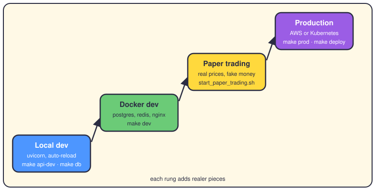
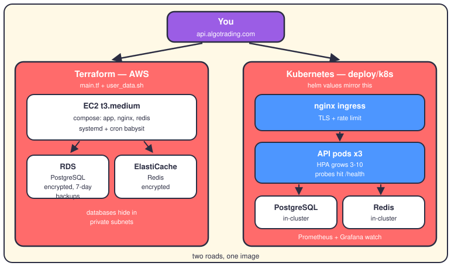

# How the app runs

## The short version

The same Python app runs in four places: your laptop, a Docker stack, a paper trading setup, and production. Each step up adds realer pieces around unchanged code. Docker packs the app into one image, and Compose wires it to PostgreSQL and Redis on your machine. For the real thing the repo offers two roads: Terraform builds an AWS box, or Kubernetes runs the API as three self-healing pods.

## The ladder of environments

**Local dev — just Python.** Run `make api-dev` and uvicorn serves the API on port 8000 with auto-reload. `make db` starts only PostgreSQL and Redis as containers. Fast to start, fast to break, and the brain layers need zero setup.

**Docker dev — the whole zoo.** `make dev` runs `docker-compose.dev.yml`. You get the app, PostgreSQL, Redis, nginx, worker and scheduler containers, plus Flower, Prometheus and Grafana. Your source folder mounts into the container, so edits show up at once.

**Paper trading — the dress rehearsal.** `scripts/start_paper_trading.sh` starts the API in the background, then the NiceGUI dashboard in front of it. Stop everything with `stop_paper_trading.sh`. Real prices flow, no cash moves.

**Production — pick a road.** `make prod` (or `make deploy`) brings up `docker-compose.prod.yml` against managed AWS databases. Or you apply the Kubernetes manifests in `deploy/k8s`. Same Docker image either way; only the surroundings change.

## What production actually looks like

**The Terraform road.** `infrastructure/terraform/main.tf` builds a VPC with public and private subnets in two zones. Inside it: an EC2 instance, RDS PostgreSQL and ElastiCache Redis. Both databases sit in private subnets, encrypted, with seven days of backups. On first boot, `user_data.sh` installs Docker, writes a `.env` with the database endpoints, and registers a systemd service. A cron job checks the containers every five minutes; another one backs up nightly.

**The Kubernetes road.** The Deployment in `deploy/k8s` runs three API pods with rolling updates and health probes on `/health`. A Horizontal Pod Autoscaler grows them from three to ten pods when CPU passes seventy percent. The ingress terminates TLS through cert-manager and rate-limits requests. Helm values in `deploy/helm` mirror the same numbers.

Two honest notes. The `worker` and `scheduler` Docker targets exist but still just run uvicorn, because no Celery app module exists yet. And the Kubernetes image is a placeholder, `ghcr.io/YOUR_ORG`, so point it at your own registry first.

One moving part sits under both roads: migrations. Alembic schema changes live in `app/infrastructure/persistence/database/migrations`. Run `make migrate` to apply them, and `make migration name="add table"` to create one.

## Ports and processes

- `8000` — the API. uvicorn locally, in every container, and in every pod.
- `8001` — the metrics port for the API in Kubernetes (`/metrics`).
- `8501` — the dashboard address that `start_paper_trading.sh` prints.
- `8503` — where the NiceGUI dashboard actually listens (`make dashboard`).
- `5432` — PostgreSQL: compose container, RDS, or in-cluster pod.
- `6379` — Redis: compose container, ElastiCache, or in-cluster pod.
- `80 / 443` — nginx and the Kubernetes ingress. HTTPS ends here.
- `9090` Prometheus · `3000` Grafana · `5601` Kibana · `9200` Elasticsearch · `5555` Flower.
- `7497` — IBKR's TWS gateway, from `.env.prod.example`.

## Where it lives

- `Dockerfile` — one image, five build targets: production, development, testing, worker, scheduler.
- `docker-compose.yml`, `.dev.yml`, `.prod.yml`, `.logging.yml` — the base, dev, prod and ELK stacks.
- `deploy/` — k8s manifests, Helm values, nginx configs, Prometheus and Grafana setup.
- `infrastructure/terraform/` — `main.tf` and `user_data.sh`, everything AWS.
- `Makefile` — every shortcut: `up`, `down`, `dev`, `build`, `deploy`, `prod`, `migrate`.
- `alembic.ini` — points Alembic at the migrations folder inside `app/`.
- `scripts/start_paper_trading.sh` and `stop_paper_trading.sh` — the rehearsal controls.

## Want to go deeper?

- [The SRE hat](18-hat-sre.md) — keeping all of this alive day to day.
- [Observability](27-observability.md) — the metrics and logs stack in detail.
- [The config atlas](24-config-atlas.md) — every knob, and where it's set.
