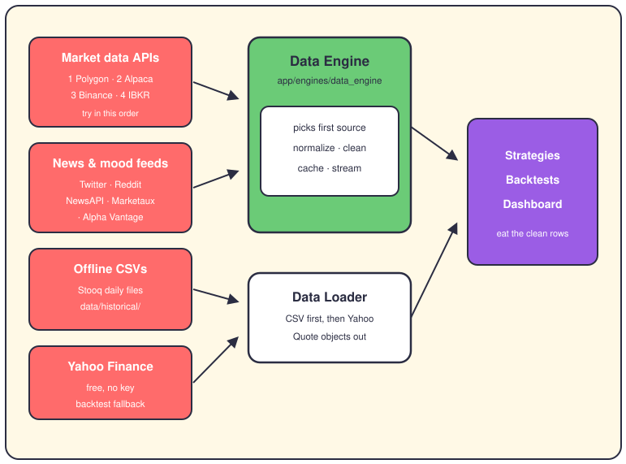

# The catalog of data sources

## The short version

This page is the reference sheet: every well the robot can drink from, and what each one costs you. Page 4 explains the pipeline itself; this page lists the sources it draws on. Each entry gets a role: primary, fallback, or offline.

## The source map

Coral is the outside world, mint picks and shapes, white loads files, grape is where data lands. The numbers on the market box are the engine's fallback order.

## Polygon

- Gives you OHLCV bars (open, high, low, close, volume) for stocks, plus option chains on the same key.
- Env var: `POLYGON_API_KEY`, from polygon.io. Paid plans; the free tier is delayed.
- Limits: one call asks for up to 50,000 bars, though the YAML config mentions 10,000.
- Role: primary. First in the engine's chain, and the only wired options provider.
- One gap: the date-range wiring is half-built. The code computes the range, then drops it.

## Alpaca

- Gives you daily or intraday stock bars from the `/v2/stocks/{symbol}/bars` endpoint.
- Env vars: `ALPACA_API_KEY`, `ALPACA_SECRET_KEY`, `ALPACA_BASE_URL` (paper URL by default).
- Limits: up to 10,000 bars per call.
- Role: fallback, second in the chain. The same keys also run paper trading, so you likely have them.

## Binance

- Gives you crypto candles — BTCUSDT and friends — from the public `/api/v3/klines` endpoint.
- Env vars: none. The public API needs no key at all.
- Limits: 1,000 candles per call; the config can page through more.
- Role: fallback for crypto, third in the chain. No stock data lives here.

## IBKR (Interactive Brokers)

- Gives you bars and live prices straight from your broker, through TWS or IB Gateway (their desktop apps).
- Env vars: `IB_HOST`, `IB_PORT` (`7497` paper, `7496` live), `IB_CLIENT_ID`, `IB_ACCOUNT`.
- Limits: no internet API key — instead you need their app running and logged in.
- Role: fallback, last in the chain. It's also the road to real trading; page 12 covers it.

## Alpha Vantage

- Gives you company fundamentals plus a news feed with sentiment scores already computed.
- Env var: `ALPHA_VANTAGE_API_KEY`. The free tier exists but throttles you hard.
- Role: real today, on two roads — a fundamentals source and one of three news providers.
- Heads-up: `docs/developer/DATA_SOURCES.md` still lists this as "future". That's stale; the code is live.

## Financial Modeling Prep

- Gives you company profiles, income statements, balance sheets, and ratios like P/E.
- Env var: `FMP_API_KEY`, from financialmodelingprep.com.
- Role: primary for fundamentals. Connecting fails fast when the key is missing.
- Alpha Vantage covers the same ground as its backup.

## Stooq CSVs and Yahoo Finance

- Stooq is a free price-history site. The repo keeps seven of its daily OHLCV files in `data/historical/`: AAPL, AMZN, GOOGL, META, MSFT, NVDA, TSLA.
- No env var, no network. This is the offline road, and backtests live on it. Some files reach back to 1984.
- Stooq is provenance (where the files came from), not code — no script here re-downloads them.
- Yahoo is the live backup: `YAHOO_FINANCE_ENABLED=True`, no key, free, delayed 15 minutes.
- The `DataLoader` tries three Yahoo roads in order: the v8 chart API direct, the `yfinance` library, then `yahoo_fin`.

## Twitter (X)

- Gives you a mood score from recent tweets that mention your symbol.
- Env var: `TWITTER_BEARER_TOKEN`. It only works through the optional `tweepy` library.
- Limits: 100 tweets per search, and only the first 10 get scored.
- Honest bit: scoring is keyword matching — "moon" counts as good, "crash" as bad. The direct API path is not implemented.

## Reddit

- Gives you a mood score from posts in r/wallstreetbets, r/stocks and r/investing.
- Env vars: `REDDIT_CLIENT_ID`, `REDDIT_CLIENT_SECRET`. Public reads work without them.
- Limits: 25 posts per request and 50 total by default; ten get sampled for the score.
- Honest bit: same crude keyword scoring as Twitter.

## News APIs: NewsAPI and Marketaux

- One class, three providers picked by config: NewsAPI (the default), Marketaux, Alpha Vantage.
- Env vars: `NEWS_API_KEY`, `MARKETAUX_API_KEY` — Alpha Vantage reuses its own key.
- Marketaux is the fancy one: sentiment arrives pre-scored, in English and Spanish, weighted by match strength.
- Limits: up to 100 articles per call; ten titles get sampled for the local score.

## Options and FX extras

- `OptionsVolatilitySource` pulls option chains (strikes, implied volatility, Greeks) from Polygon's snapshot endpoint.
- Its IBKR branch just logs "not implemented yet" and returns — a stub, not a source.
- The forex risk tracker reads official exchange rates from the ECB and Banco de España.

## Fallback order

The verified chain in `data_engine.py` is: **polygon → alpaca → binance → ibkr**. The engine takes the first one present in your config. It doesn't retry the next on failure — a failed call just returns an empty list.

Backtests run their own chain: the CSV file first, then the three Yahoo roads. Fundamentals take whoever's configured, FMP or Alpha Vantage. Sentiment is different: it fans out to every configured feed at once, then merges the scores.

## Where it lives

- `app/engines/data_engine/sources/ohlcv_sources.py` — Polygon, Alpaca, Binance, IBKR, plus an unused Yahoo class.
- `app/engines/data_engine/sources/fundamental_sources.py` — FMP and Alpha Vantage fundamentals.
- `app/engines/data_engine/sources/sentiment_sources.py` — Twitter, Reddit, and the news providers.
- `app/engines/data_engine/sources/options_sources.py` — Polygon option chains and the IBKR stub.
- `app/engines/data_engine/data_engine.py` — the fallback list and the fan-out logic.
- `app/backtesting/data_loader.py` — the CSV and Yahoo roads, `Quote` objects out.
- `config/market/data_engine.yaml` — per-source limits and defaults.
- `.env.example` — every key name, with where to get each one.
- `data/historical/` — the seven Stooq CSVs.

## Want to go deeper?

- [The data pipeline](04-data-pipeline.md) — how these sources feed one engine.
- [The IBKR connection](12-ibkr.md) — the broker feed in detail.
- [The config atlas](24-config-atlas.md) — every knob, including these.
