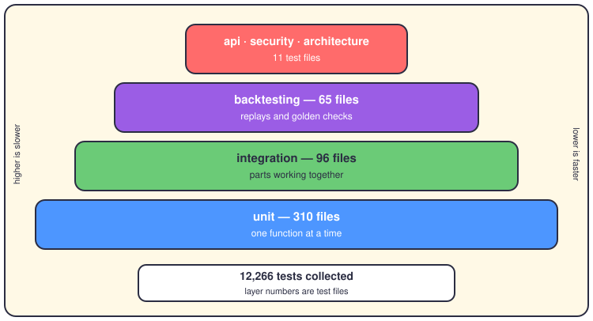

# Testing: how we know it works

## The short version

The repo holds about 12,266 tests, and one command runs them all: `make test`. Most are unit tests, which check one small piece of code with everything else faked. On top sit integration tests, backtest checks, and a small set of API and security tests. Pytest also measures coverage — the share of `app/` code the tests actually run — and fails below 80 percent. GitHub Actions runs the suites on every push, so a bad change gets caught before you merge it.

Here's the pyramid as it really is, with the real file counts from `tests/`:



## The layers

The base is wide because that's where tests are cheapest. Each item quotes files that really exist.

- **Unit — 310 files.** The wide base. `tests/unit/` has 47 subfolders, one per area of `app/`: `engines/`, `metrics_database/`, `reporting/`, `ml/`, and more. Real examples: `test_breakout_engine.py`, `test_questdb_connector.py`, `test_pyfolio_integrator.py`. Each test feeds a function tiny fake inputs and checks its answer.
- **Integration — 96 files.** Folders like `tests/integration/execution/` and `tests/integration/risk/` check that several parts work together. Brokers and databases stay faked, so the tests stay honest but cheap.
- **Backtesting — 65 files.** These replay old market data through the strategies. `tests/backtesting/core/test_golden_invariants.py` holds the "golden" checks: fixed facts about results that must never drift. `test_monte_carlo_analysis.py` stress-tests the statistics behind them.
- **The small top — 11 files.** `tests/api/test_security_auth.py` pokes the API's front door. `tests/security/test_csrf_protection.py` and `test_secrets_manager.py` guard keys and headers. One architecture test reads the source and enforces the Clean Architecture dependency rules.
- **The special weapons.** `tests/unit/property_tests/` holds Hypothesis tests like `test_greeks_properties.py`. Property-based means the tool generates hundreds of random inputs and hunts for any value that breaks the math. `tests/sre/monitoring/test_golden_signals.py` covers the four golden signals of health. Stress and load tests live in `tests/load/`.

Shared plumbing matters too. `tests/conftest.py` provides the fixtures every suite reuses, and `tests/mocks/` plus `tests/fixtures/` hold the fakes. `pytest-xdist` is installed, so you can spread a run over several CPU cores.

## The gates

Three gates stand between you and a broken `main`:

- **Coverage.** `pyproject.toml` sets `--cov-fail-under=80` with branch coverage on, inside `addopts`. Even plain `pytest` enforces the gate, not just `make test-cov`. Reports land in `htmlcov/` and `coverage.xml`.
- **Markers.** `--strict-markers` plus 19 registered markers (`unit`, `critical`, `slow`, `overnight`, `requires_broker`...). Typo a marker and the run stops instead of skipping silently.
- **CI.** `.github/workflows/testing.yml` runs the unit, integration, load and security suites and enforces the coverage threshold. A separate security-audit workflow adds its own scan.

On your laptop, pre-commit runs `ruff`, `ruff-format`, `bandit` and `detect-secrets` before every commit. It even runs `vale-eli5`, which lints these very pages.

## Known failures

Here's the honest part. There is no tracked list of known failures — `tests/README.md` describes categories and runtimes, nothing more. I collected the suite (12,266 tests in about 46 seconds) but didn't run it, so I won't invent pass or fail numbers. Two gaps I did verify: `tests/README.md` tells you to run `python run_tests.py`, but that file doesn't exist. And `tests/load/` holds no pytest files, while `make load-test` points at a locustfile that isn't there either. Heavy tests also hide behind markers like `slow` and `requires_broker`, so everyday runs skip them by choice, not by accident.

## How to run

```bash
make test                              # everything, verbose
make test-cov                          # same, with the 80 percent gate
pytest tests/unit -v                   # just the fast base
pytest -m critical                     # only the must-pass tests
pytest -k "stop_loss"                  # only names matching this
pytest --lf                            # re-run what just failed
pytest tests/unit/property_tests       # the Hypothesis tests
make test-file file=tests/api/test_assets.py   # one file, via Make
```

## Where it lives

- `tests/` — every suite; `tests/README.md` explains the categories.
- `pyproject.toml` — `[tool.pytest.ini_options]` and `[tool.coverage.*]`.
- `Makefile` — `test`, `test-cov`, `test-file`, `integration-test`.
- `.pre-commit-config.yaml` — the gate on your machine.
- `.github/workflows/testing.yml` — the gate in the cloud.
- `.hypothesis/` — Hypothesis's memory of inputs that once broke things.

Where next? [The developer hat](16-hat-developer.md) shows where to code. [The engineering rulebook](21-engineering-rules.md) holds the rules behind these gates. And [backtesting](09-backtesting.md) explains what the replay tests actually check.
