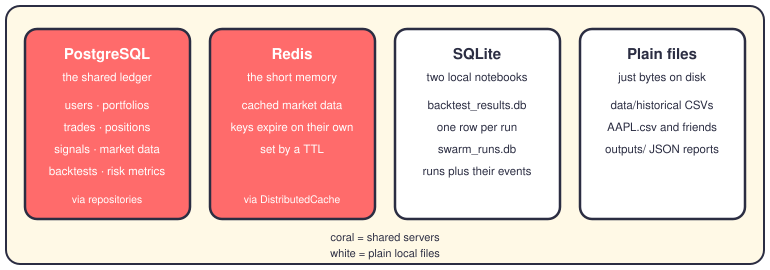
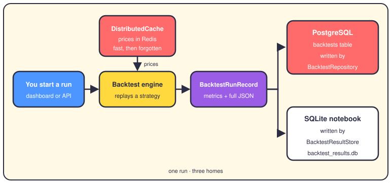

# Where data lives

## The short version

Everything this system remembers sits in one of four homes. PostgreSQL is the shared ledger: users, portfolios, trades, signals. Redis is the short-term memory for market data. Two SQLite files act as local notebooks, one for backtests and one for swarm runs. Plain files hold the raw stuff, like price CSVs and JSON reports.

Once you know which home a piece of data lives in, you also know how long it lasts and who else can read it. Here's the map:



**PostgreSQL — the shared ledger.** This is the database of record, meaning the place where truth is kept. It holds about a dozen tables: `users`, `api_keys`, `portfolios`, `assets`, `positions`, `trades`, `market_data`, `signals`, `backtests`, `risk_metrics` and friends. Your code never writes SQL for them by hand. Repository classes like `TradeRepository` or `BacktestRepository` do all the talking.

**Redis — the short memory.** The data engine wraps Redis in a class called `DistributedCache`. Fetched prices get a key and a TTL (time to live), then they quietly expire. If the `redis` package isn't installed, the same class falls back to plain in-memory caching. The defaults live in `RedisConfig`: localhost, port 6379, database zero.

**SQLite — the two notebooks.** `backtest_results.db` is served by `BacktestResultStore`: one row per run in the `backtest_runs` table, with the key metrics in columns and the full result as JSON. The dashboard's history pages read it. `swarm_runs.db` is served by `SwarmRunStore`: tables `swarm_runs` and `swarm_events`, so Mission Control can replay a run after it ends. Both files use WAL (write-ahead logging), so the API and dashboard processes can share them without blocking each other.

**Plain files.** `data/historical/` holds one CSV per ticker, and that's what backtests replay. `outputs/` holds JSON state and reports. Nothing expires and nobody serves them; they're just files on disk.

## One backtest, three homes

A single backtest run touches three of the homes at once. Watch it flow:



You ask for a run, the engine replays a strategy over prices, and `DistributedCache` serves those prices from Redis when they're fresh. The finished run becomes a `BacktestRunRecord`. Its tidy summary goes to PostgreSQL through `BacktestRepository`, and the full record goes to the SQLite notebook through `BacktestResultStore`.

## Migrations

When you change a table in the SQLAlchemy models, the real PostgreSQL schema has to follow. Alembic is the tool that keeps them in sync. A migration is just a versioned Python file that adds or drops columns, and Alembic remembers which ones already ran.

In this repo, `alembic.ini` sits at the root and points at `app/infrastructure/persistence/database/migrations/`. The `env.py` inside takes the database URL from your settings, or from the `ALEMBIC_DB_URL` variable. Two revisions exist today: the initial schema and one for FIFO tax tracking.

The two commands you'll actually type:

```bash
make migrate                          # apply everything: alembic upgrade head
make migration name="add foo table"   # autogenerate a revision from your models
```

There are also helpers in `scripts/migrations/` for status, rollback and stamping. The SQLite stores skip all of this. They run `CREATE TABLE IF NOT EXISTS` the first time they open, so they upgrade themselves.

## Where it lives in the code

- `app/infrastructure/persistence/database/models.py` — the SQLAlchemy tables for PostgreSQL.
- `app/infrastructure/persistence/database/_*_repositories.py` — one file per area, gathered in `repositories.py`.
- `app/infrastructure/persistence/backtest_result_store.py` — SQLite store for backtest runs.
- `app/services/agent_swarm/store.py` — `SwarmRunStore` and its two tables.
- `app/engines/data_engine/cache/distributed_cache.py` — the Redis-plus-PostgreSQL cache.
- `alembic.ini` and `app/infrastructure/persistence/database/migrations/` — schema changes.
- `data/historical/` and `outputs/` — the plain files.

## Want to go deeper?

- [Backtesting](09-backtesting.md) — what produces most of these rows.
- [The agent swarm](23-agent-swarm.md) — the runs behind `swarm_runs.db`.
- [The config atlas](24-config-atlas.md) — where the settings for all of this live.
