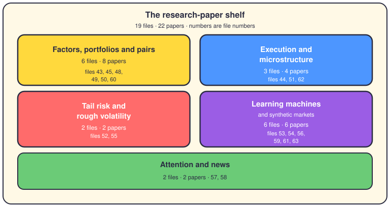

# The research-paper rules

## The short version

`config/rules/trading/papers/` is the second room of the rules library. [The trading rulebook](20-trading-rules.md) showed you the books; this page walks the 19 files in the `papers/` subfolder. Each file takes one research paper — sometimes two — and turns it into blunt orders with Python sketches.

Sixteen files carry 15 numbered rules each, about 240 in total; files 43, 44 and 45 are looser summaries. Everything is written in Spanish; here it is in English, cut to the lines that shape the code. The number in each heading is the file number, so `papers/49-*.md` is the pairs trading paper. The count runs straight on from the book shelf: books 46 and 47 sit upstairs, between papers 45 and 48.

## Factors, portfolios and pairs

The classic quant papers: where returns come from, and how to spread capital across assets.

### 43. Fama-French-Carhart factors — Fama & French (1993), Carhart (1997)
Most of a stock's return comes from a few shared factors: market, size, value, momentum.
- Explain returns with MKT, SMB, HML and UMD before you claim any alpha.
- Alpha must be positive and statistically significant, not beta in disguise.
- Time the factors by regime: momentum in bull markets, value as defense in bear ones.
- Rebalance monthly for momentum, yearly for value and size.

### 45. Momentum — Jegadeesh & Titman (1993), Asness et al. (2013)
Winners keep winning for 3 to 12 months, in almost every asset class.
- Rank on the last 12 months of returns and skip the newest month.
- Long the top 30%, short the bottom 30%, rebalance monthly.
- Scale each position to a 10-15% volatility target.
- Blend value and momentum half and half; their correlation stays near zero.

### 48. Portfolio Selection — Harry Markowitz (1952)
Optimize the trade-off between risk and return, not return alone.
- Build the covariance matrix from at least 252 trading days.
- Shrink it with Ledoit-Wolf; never trust the raw sample matrix.
- Standard profiles are long-only, weights sum to one, max 20% per asset.
- If the optimizer fails, fall back to risk parity (inverse volatility).

### 49. Pairs Trading — Gatev, Goetzmann & Rouwenhorst (2006)
Cointegrated pairs drift apart, then drift back together. You trade the gap.
- Form pairs on 12 months of data, then trade the next 6.
- The cointegration test is mandatory: Engle-Granger or Johansen, with a p-value below five percent.
- Open at |Z| above 2, exit at zero, stop at |Z| above 4 or after 30 days.
- Size the two legs by beta so the pair stays dollar-neutral.

### 50. Arbitrage Pricing Theory — Stephen Ross (1976)
Returns load on several macro factors, not just the market.
- Regress returns on at least four macro factors, using surprises (actual minus consensus).
- Reclassify by beta: oil beta above 0.5 means energy-dependent, whatever the sector label says.
- Estimate betas on rolling 60-month windows; macro regimes change slowly.
- After a macro shock beyond 3 SD, re-optimize the portfolio at once.

### 60. Online Portfolio Selection — Li & Hoi (2014)
Rebalance daily by reacting, with no return forecasts at all.
- No forecasting: react to today's relative returns; buy what just fell.
- Rebalance only when the expected gain beats the commission.
- Keep the weights on the simplex: they always sum to exactly one.
- Average several online algorithms instead of betting on one.

## Execution and microstructure

How to send orders without paying too much for the privilege.

### 44. Optimal Execution and Market Making — Almgren-Chriss (2001), Avellaneda-Stoikov (2008)
The math for the trade-off between trading fast and moving the market.
- Split impact into permanent and temporary parts; estimate both before you trade.
- Front-load the schedule when risk-averse; the risk-neutral path is VWAP.
- Widen your quotes with volatility, and skew them with inventory.
- End the session near zero inventory; force liquidation near the close.

### 51. Market Microstructure — Joel Hasbrouck (2007)
Spreads, order flow and price discovery tell you what trading really costs.
- Measure the effective spread (2 × |price − mid|); if it beats the quoted one, execution is poor.
- Track VPIN to smell toxic order flow before volatility arrives.
- Microstructure signals die in seconds: execute at once or cancel.
- Route by fill probability, not by the best price on screen.

### 62. Algorithmic Trading and DMA — Barry Johnson (2010)
Professional order handling: slicing, hiding, routing. (He also wrote book rule 29.)
- Slice big orders into child orders under 5% of minute volume.
- Wait between slices so liquidity can recover.
- Skip the first and last five minutes of the session.
- Stop routing to venues where your slippage runs systematically high.

## Tail risk and rough volatility

The shapes of disaster, and how to measure them honestly.

### 52. Expected Shortfall — Artzner, Delbaen, Eber & Heath (1999)
VaR breaks when you add positions; ES (CVaR) doesn't, so it leads.
- Use ES at 95% as the main risk metric and recalculate it every 24 hours.
- If ES over VaR passes 1.5, call the asset fat-tailed and halve its allowed size.
- Size positions as account risk divided by CVaR.
- If today's drawdown passes yesterday's ES, close half your positions.

### 55. Rough Volatility — Bayer, Friz & Gatheral (2016)
Volatility is rough (Hurst below 0.5), which makes its near future predictable.
- Model log-volatility with fractional Brownian motion; keep the Hurst exponent under one half.
- Estimate the Hurst exponent daily, with R/S analysis or variograms.
- Use roughness to forecast short-term volatility spikes.
- Match your hedging and rebalancing frequency to the measured roughness.

## Learning machines and synthetic markets

Networks that read the order book, learn a policy, evolve, or invent whole markets.

### 53. DeepLOB — Zhang et al. (2019)
Treat the order book as a picture: a CNN reads the levels, an LSTM reads time.
- The input is a 10-level × 40-event matrix, never a flat series.
- Predict three classes — up, down, neutral — at 10, 50 and 100 ticks ahead.
- Feed order flow imbalance and micro-price; normalize over a rolling event window.
- Keep inference under 1 ms, or the signal is stale on arrival.

### 54. Deep RL for Trading — Yang et al. (2020)
An agent learns to trade from a risk-adjusted reward, not from rules you wrote.
- Use PPO so policy updates stay small; average PPO, A2C and DDPG at trade time.
- Reward is incremental Sharpe, not profit; subtract commissions and drawdown pain.
- Actions are continuous weights from -1 to +1; scale all inputs to 0-1.
- Give the agent the current volatility regime as part of its state.

### 56. Temporal Fusion Transformers — Lim et al. (2021)
A transformer that forecasts many horizons at once and can explain itself.
- Predict quantile curves (10, 50 and 90%), not one next point.
- Let variable selection layers pick which indicators matter right now.
- Feed log returns and calendar features over at least 128 periods.
- Save the attention weights so you can report why the model decided.

### 59. Neural SDEs — Kidger et al. (2020)
Learn the drift and diffusion of a stochastic equation, and treat ticks as a continuous flow.
- Networks learn the drift and diffusion coefficients of the equation.
- Handle irregular time gaps without linear interpolation.
- Train with the adjoint method to keep memory use low.
- Respect boundaries — prices can't go negative — and recalibrate after every candle.

### 61. Adaptive Markets Hypothesis — Andrew Lo (2017)
Markets are ecosystems: strategies compete, decay, and get replaced.
- Detect the regime with an HMM; keep a pool of sub-strategies and switch by regime.
- Test new rules with 1% of capital while 99% follows proven ones.
- Cut position size after three straight losses from a strategy.
- An outside process must audit whether the robot has gone obsolete.

### 63. GANs for Financial Time Series — Wiese et al. (2020)
Generators invent synthetic markets, so you can stress test and catch overfitting.
- Generate synthetic ticks and force tail events like flash crashes.
- If the bot only wins on real data, it is overfit.
- Never report one backtest number; report a distribution over 10,000 synthetic markets.
- Synthetic volume must stay consistent with the price moves.

## Attention and news

What the crowd searches for, and what the news says, turned into features.

### 57. Asset Pricing with Attention — Da, Engelberg & Gao (2011)
Google search volume is retail attention, and attention moves prices.
- Use Google Trends (ASVI) as an input feature; trade only past spikes of 1.5 SD.
- Expect reversal after attention spikes on small caps.
- Retail takes 1-3 days to react, so program a delay.
- Market-wide "recession" searches rising? Cut your risk.

### 58. NLP for Financial News — Lillo et al.
News text scored in milliseconds is alpha, especially next to microstructure data.
- Score each story from -1 to +1 in milliseconds; extract tickers, names and currencies.
- Weight premium terminals over social media; demand two sources for high confidence.
- In the 30-minute event window after a release, technical indicators stand down.
- Macro news keeps its impact longer than company news.

## Where it lives

- `config/rules/trading/papers/` — the 19 paper files, numbered 43 to 63, written in Spanish.
- Files 48 to 63 hold 15 numbered rules each, with Python sketches; files 43, 44 and 45 are older summaries.
- The numbering continues the top-level book files, so books 46 and 47 sit upstairs, between papers 45 and 48.

**Read next:** [The trading rulebook](20-trading-rules.md) · [The bibliography](22-bibliography.md) · [Optimization](26-optimization.md)
