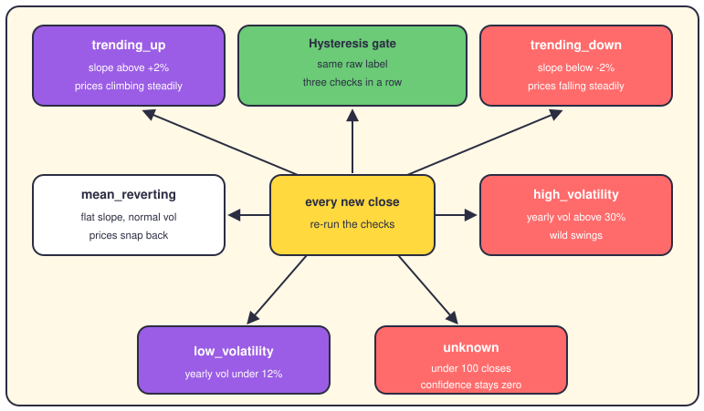
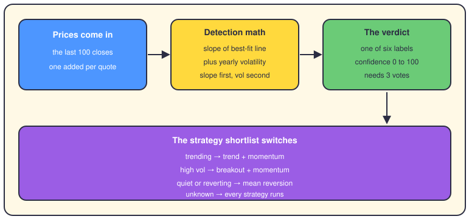

# Regime detection: reading the market's mood

## The short version

Markets have moods. Sometimes prices climb for months, sometimes they thrash around wildly, and sometimes they just drift. A regime is a name for the mood the market is in right now. The app works the mood out from price history alone. It matters because the regime decides which strategies are allowed to trade.

## The six regimes

The `RegimeBasedSelector` in the strategy ensemble owns this job during live trading. It keeps its own price history: every quote adds one close, and only the last 200 are kept. The math reads the last 100 closes (`regime_lookback`). With fewer than 100, the regime is `unknown` and confidence stays at zero.

Detection measures two things. First, trend: fit a straight line through the 100 closes, take its slope, and divide by the average price. If that normalized slope is above 2%, the regime is `trending_up`; below -2%, it's `trending_down`. Trend is always checked first, so a real trend is never mislabeled as noise.

Second, volatility: the spread of daily returns, scaled up to a yearly figure. Above 30% a year, the regime is `high_volatility`. Under 12% a year — that's the 30% line times 0.4 — it's `low_volatility`. A flat slope with volatility in between is called `mean_reverting`.

Raw labels would flip-flop on noisy days, so there's a hysteresis gate. The regime only changes after the same raw label shows up three checks in a row. Until then, the old regime stands. Confidence grows with how far the slope or volatility overshoots its threshold, capped at 100. Every outgoing signal carries the regime and its confidence in its metadata.

## What the regime switches

The regime picks the shortlist of strategies that may generate signals, through `regime_strategy_map`. Trending markets run `trend_following` and `momentum_engine`, and `trending_up` adds breakout. Quiet and reverting markets hand the mic to `mean_reversion_engine`. Wild markets go back to breakout and momentum. When the regime is `unknown`, or the preferred names aren't loaded, every strategy runs — nothing goes silent by accident.

Backtesting speaks a second language. Its detector labels the market bull, bear or neutral: bull is price above the 200-day average with a rising slope. It also grades volatility low, normal or high against the historical median. Structure gets called trend, range or transition from the fit's R-squared (how well a line explains prices). A separate detector uses a hidden Markov model, or HMM — a statistical machine that guesses which hidden state produced the returns you see. It learns states from returns and rolling volatility, then names them bear, sideways or bull by average return. The regime doesn't reweight anything in a backtest; it slices the run into pieces and scores the strategy inside each slice.

## When detection fails

Every detector has a plan B. The ensemble's selector says `unknown` when it lacks history, and `unknown` means all strategies run — the failure is soft. The HMM path needs `hmmlearn`, an optional package. When it's missing, a fallback class wraps sklearn's `GaussianMixture`, which clusters states but forgets time. It treats every day as independent and hands every state the same transition odds. The swap is logged as a warning, and `pip install hmmlearn` restores the real model.

The backtest runner chains its fallbacks. It tries the HMM first; if training fails, it retries with K-means clustering. If that fails too, a simple threshold method labels each day bear, neutral or bull from return and volatility cutoffs. Under 252 quotes the regime test is skipped entirely. And a detector that errors returns `unknown` with zero confidence instead of crashing.

## Where it lives in the code

- `app/engines/strategy_engines/ensemble.py` — `RegimeBasedSelector`: the six regimes, the thresholds, hysteresis, and the strategy map.
- `app/backtesting/validation/regime_detector.py` — bull, bear, neutral plus volatility and structure; defaults in `models.py` (`RegimeConfig`).
- `app/engines/context_engine/regime_detectors/hmm_regime_detector.py` — `HMMRegimeDetector` and the `GaussianMixture` fallback.
- `app/engines/context_engine/volatility_analyzers/volatility_regime_detector.py` — high, normal, low volatility by percentiles 75 and 25.
- `app/services/regime_detection_chan.py` — Ernest Chan's version, with hmm, kmeans, threshold and momentum methods.
- `app/backtesting/comprehensive_backtest_runner.py` — `run_regime_test_backtest`: the fallback chain and per-regime scoring.
- `docs/developer/HMMLEARN_FALLBACK_QUICK_REFERENCE.md` — the hmmlearn swap, in detail.

## Want to go deeper?

- [The strategies](05-strategies.md) — the engines the regime chooses between.
- [Backtesting](09-backtesting.md) — where regime slices grade a strategy.
- [The risk engine](06-risk-engine.md) — what can veto a signal whatever the mood.
