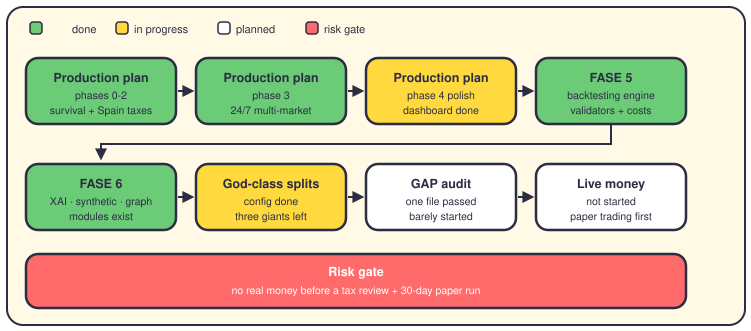

# The roadmap: where we are, where we go

## The short version

This repo carries two kinds of plans. One asks: can this system trade real money without hurting you? The other grows the brain: better backtests, fancier modules, cleaner code.

The code is ahead of the oldest plan. Position monitoring, Spain tax tracking, and 24/7 market services all exist in `app/` today. The dashboard was just consolidated on NiceGUI, and this ELI5 series is brand new.

But the last mile is untouched. Three giant files still need splitting, a code audit barely started, and no real money has ever traded. Here is the honest map.

## The production plan (five phases, 28 weeks)

`PLAN_SUMMARY.md`, `VISUAL_ROADMAP.md`, and `ROLLOUT_PLAN.md` (written January 2025) split the road to production into Phases 0 to 4, with a decision gate after each.

Phases 0 to 3 look done in code. `app/services/position_monitor/` and `emergency_handler/` exist, plus `app/infrastructure/resilience/reconnection_manager.py` and a memory monitor. That covers Phase 1, survival.

Phase 2 left real files too: `app/services/fifo/fifo_integrator.py`, `modelo_721_generator.py`, and a Spain tax engine under `app/services/tax_efficiency/engines/`. A commit this month fixed FIFO sync sessions.

Phase 3 services all exist: `market_scheduler.py`, `forex_risk/`, `broker_failover/`, `rate_limiting/`, and `news_processor/`. Phase 4 is half done — the dashboard is now NiceGUI only, Streamlit is gone, and 46 E2E tests came with it.

What remains: there's no evidence of a 30-day stability run, a full runbook, or any live-money stage. Gate 4 hasn't been passed.

## FASE 5: the backtesting engine

The plan wanted strategy validators, a 5% daily circuit breaker, honest cost models, and vectorized code. Target: 95% rule compliance.

Almost all of it exists now. `app/backtesting/validation/strategy_validator.py` sits next to walk-forward and overfitting checks. `app/services/circuit_breaker/daily_circuit_breaker.py` is real.

The cost side is real too: `slippage_model.py`, `transaction_cost.py`, and `market_impact.py` under `app/backtesting/execution/`. Recent commits fixed drawdown, Sharpe, and Sortino math, plus fills at the next bar's open.

What remains: the plan's clean-bill criteria (strict mypy, 95% compliance) can't be verified from the repo, so treat FASE 5 as done but unproven.

## FASE 6: the advanced modules

The plan describes three showpieces: explainable AI with SHAP and LIME, synthetic data from GANs, and a knowledge graph on Neo4j.

The folders exist and hold code: `app/services/xai/`, `synthetic_data/`, and `knowledge_graph/`. What remains is proving they're wired into daily trading, not just importable.

## The refactoring waves

`REFACTORING_PLAN_GOD_CLASSES.md` wanted four giants split into small files. One is done: `centralized_config.py` went from about 3,800 lines to 860. The other three still stand: the backtest runner at 4,615 lines, the compliance engine at 3,866, and `select_strategy.py` at 2,278.

`REFACTORING_SUMMARY.md` reports duplicate modules deleted and one unified metrics module created. Hard-coded values for trading days and the risk-free rate still live in about 30 files.

The portfolio dependency-injection plan is done: `app/core/di_container.py` exists and a recent commit wired it in. The GAP audit is the laggard — its plan wants every file audited layer by layer, but only one file shows a PASSED stamp.

## Snapshot date

This page is a snapshot from October 2026, and every commit it cites landed on one busy day that month. Plans age fast here. Check `git log` before you trust any status above.

## Where it lives

- `docs/plans/PLAN_SUMMARY.md`, `ROLLOUT_PLAN.md`, `VISUAL_ROADMAP.md` — the production plan.
- `docs/plans/FASE5_Backtesting_Engine.md`, `FASE_6_ADVANCED_MODULES.md` — the engine phases.
- `docs/plans/fix_gap_violations.md`, `refactor-portfolio-di.md` — the cleanup plans.
- `docs/REFACTORING_PLAN_GOD_CLASSES.md`, `docs/REFACTORING_SUMMARY.md` — the splits.
- `docs/architecture/backtesting_workflow_complete_analysis.md` — how a backtest flows today.

## Want to go deeper?

- [Backtesting](09-backtesting.md) — what the engine does with your history.
- [Optimization](26-optimization.md) — tuning strategies without fooling yourself.
- [Deployment](28-deployment.md) — how this leaves your laptop.
