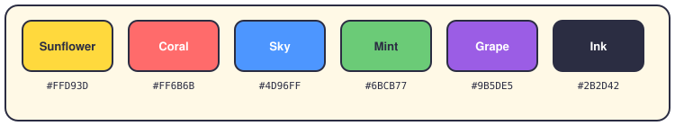

# ELI5 — AlgoTrading, explained simply

This folder is the friendly part of the documentation. No jargon walls, no 4,000-line file names. Just what the system does, how a trade happens, and where things live in the code.

Everything here is written in simple English (around B2 level). If a sentence makes you stop and re-read it, that sentence is broken — fix it or open an issue.

## The pages

**The basics**

1. [How the system works](01-how-the-system-works.md) — the big picture, layer by layer.
2. [The life of a trade](02-life-of-a-trade.md) — follow one order from "the price moved" to "position updated".
3. [The folder map](03-folder-map.md) — what lives in each folder inside `app/`.

**One page per subsystem**

4. [The data pipeline](04-data-pipeline.md) — where prices and news come from.
5. [The strategies](05-strategies.md) — momentum, mean reversion, pairs trading, and the ensembles.
6. [The risk engine](06-risk-engine.md) — limits, gates, and circuit breakers.
7. [Execution](07-execution.md) — the order lifecycle and paper trading.
8. [The portfolio](08-portfolio.md) — positions, cash, and allocation.
9. [Backtesting](09-backtesting.md) — replay the past, get a verdict.
10. [Security](10-security.md) — API keys, JWT, and secrets.
11. [The dashboard](11-dashboard.md) — the NiceGUI app, with docs at `/docs`.
12. [The IBKR connection](12-ibkr.md) — how IBKR plugs in, and what is real today.
13. [The component playbook](13-component-playbook.md) — the logic each component applies.

**The rulebook and its sources**

20. [The trading rulebook](20-trading-rules.md) — every trading rule, grouped by the book it comes from.
21. [The engineering rulebook](21-engineering-rules.md) — the Python rules the code must follow.
22. [The bibliography](22-bibliography.md) — the books behind the rules, and where each idea landed.
33. [The research-paper rules](33-papers.md) — the papers, distilled into rules.

**Deeper layers**

23. [The agent swarm](23-agent-swarm.md) — the CAPA 2 pipeline and Mission Control.
24. [The config atlas](24-config-atlas.md) — where every knob lives.
25. [Compliance and taxes](25-compliance-tax.md) — pre-trade gates, post-trade checks, and the Spain tax engine.
26. [Optimization](26-optimization.md) — tuning, labeling, meta-labeling, and walk-forward.
27. [Observability](27-observability.md) — logs, metrics, and alerts.
28. [Deployment](28-deployment.md) — from local to Docker to Kubernetes.
34. [Regime detection](34-regime-detection.md) — how the app reads the market's mood.

**Reference**

29. [Data sources](29-data-sources.md) — every source, its env vars, and the fallback chain.
30. [Testing](30-testing.md) — the layers, the gates, and the honest state.
31. [Persistence](31-persistence.md) — Postgres, Redis, SQLite, and files.
32. [Glossary](32-glossary.md) — every term, in plain English.
35. [The API tour](35-api-tour.md) — all endpoints, and which need a key.
36. [Roadmap](36-roadmap.md) — where the project is, and where it goes.
37. [Troubleshooting](37-troubleshooting.md) — the errors you will hit, and the fix.

**One page per hat**

14. [Newcomer](14-hat-newcomer.md) — your first week on the project.
15. [Trader](15-hat-trader.md) — what the robot does with your money.
16. [Developer](16-hat-developer.md) — where to code, and how it fits together.
17. [Quant](17-hat-quant.md) — strategies, metrics, and backtests.
18. [SRE](18-hat-sre.md) — keeping the system alive and observable.
19. [Security](19-hat-security.md) — keys, secrets, and audits.

## The ELI5 palette

Every diagram in these pages uses the same small set of colors, so your eyes learn the meaning once and reuse it everywhere:

And each color always means the same thing:

| Color | We use it for |
|---|---|
| Sky `#4D96FF` | entry points — where requests and data come in |
| Mint `#6BCB77` | coordination — deciding the order of steps |
| Sunflower `#FFD93D` | the trading brain — strategies, signals, rules |
| Coral `#FF6B6B` | the outside world and things that can hurt you — infrastructure, risk |
| Grape `#9B5DE5` | results and people — portfolio, dashboards, backtests |
| Ink `#2B2D42` | text, borders and neutral boxes |
| Cream `#FFF9E6` | the background of every diagram |

## Diagram rules

- Diagrams live as `.svg` files in `diagrams/` and are embedded as images pointing at `diagrams/NN-page-N.svg`. This renders everywhere — GitHub, VS Code, MkDocs and the dashboard.
- Each file carries a `viewBox` and no fixed width, so it scales on any screen.
- Boxes are rounded (`rx="12"` or more) with an ink border 2–2.5 px wide.
- Six words per line inside a box, maximum. If it doesn't fit, the diagram is too complicated.
- Copy the palette above. Don't invent new colors — the meaning lives in the repetition.

## A note about rendering

Inline `<svg>` blocks inside markdown don't survive every viewer — GitHub strips them, and some tools print the raw markup as text. That is why every diagram here is a referenced image file instead. If you edit a diagram, edit its `.svg` file in `diagrams/` and keep the embed as an image.

## Keeping the human voice

These rules keep the pages easy to read:

- Short sentences. Contractions. Talk to "you".
- One idea per paragraph.
- When you use a technical term, explain it in the same sentence.
- Read it out loud. If you run out of breath, split the sentence.

Want a machine to check the style? Run the page through a humanizing pass (the Étincel or WriteHuman MCP servers). Or lint it with [Vale](https://vale.sh) and a readability config.
